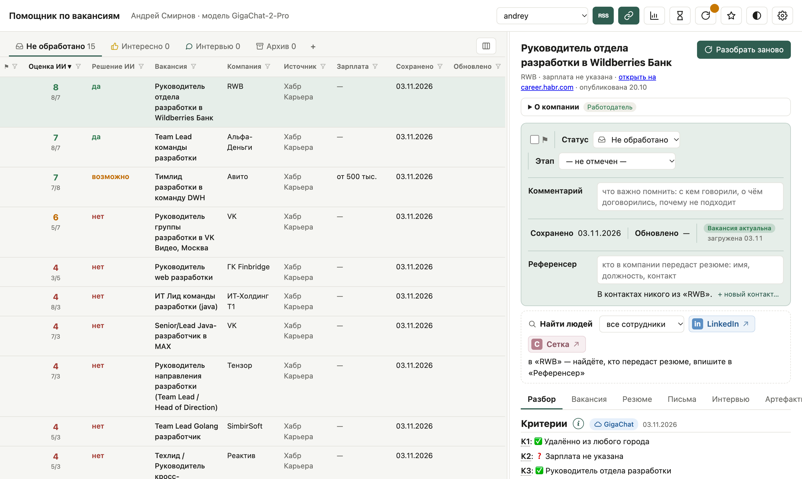

# Помощник по вакансиям

Программа для поиска работы. Вы добавляете вакансии с любых сайтов — ссылкой, сохранённой страницей или текстом, — программа оценивает каждую по вашему резюме и критериям и помогает откликнуться: пишет сопроводительное письмо и сообщение знакомому в компании, готовит к собеседованию.

Работает на вашем компьютере, окно открывается в браузере. Вакансии разбирает языковая модель:

- **Gemma** через [Ollama](https://ollama.com) — на этом же компьютере, резюме и вакансии никуда не уходят;
- или облачный **GigaChat** (Сбер) — если компьютер слабый для локальной модели;
- или **без модели** — как трекер откликов: таблица вакансий, статусы, этапы, комментарии, контакты и статистика, без оценок и писем.

Программа ничего не отправляет за вас: не откликается на hh.ru и никому не пишет.



## Что умеет

**Найти**
- Добавляет вакансию по ссылке с любого сайта (сайт компании, Хабр Карьера, SuperJob), из страницы, сохранённой в браузере (так — и вакансии hh.ru), или из вставленного текста.
- По желанию сама ищет вакансии на hh.ru по вашим запросам и отсеивает лишнее по названию. **По умолчанию выключено:** соглашение hh.ru запрещает программы для поиска и сбора данных — включаете вы, на свой риск (см. «Поиск на hh.ru»).
- Вакансии в ИТ — из RSS-лент Хабр Карьеры и GeekJob: официальный способ подписки, работает и без поиска на hh.ru.

**Оценить**
- Проверяет вакансию по вашим критериям: город, зарплата, уровень роли и всё, что вы сами запишете.
- Ставит оценки «Могу», «Хочу» и общую от 1 до 10, пишет сильные стороны, пробелы и решение — откликаться или нет.
- Своя оценка — в карточке вакансии: «Могу», «Хочу», решение и причина. Не согласны с оценкой модели — там же можно поправить критерии, резюме или «Дополнительно о себе» и пересчитать вакансию.
- Калибровка подстраивает критерии под ваши недавние оценки — прежде всего там, где модель с вами не согласна.

**Откликнуться**
- Пишет сопроводительное письмо по вашему образцу — только с фактами из резюме.
- Находит среди ваших знакомых тех, кто работает в компании вакансии, и пишет им личное сообщение.
- Открывает поиск сотрудников компании в LinkedIn и Сетке (соцсеть hh.ru).
- Подсказывает, как подогнать резюме под вакансию: что из резюме и «Дополнительно о себе» включить (чего в резюме нет — с пометкой «добавьте в резюме»), что можно не включать, новый текст «Обо мне» языком вакансии, какие навыки выделить и каких слов вакансии в резюме нет. Только ваши факты; новую версию резюме на hh вы создаёте сами.
- Находит пробелы в резюме («Резюме против рынка»): каких требований и слов из вакансий в нём не хватает — по вашим откликам и по вакансиям, которые подходят вам, а модель отвергла. Подсказывает, что дописать в резюме и что нарастить: проект, курс, сертификат.

**Подготовиться к интервью**
- Подбирает из резюме 4 истории по методу STAR под главные требования вакансии и подсказывает, как отвечать о пробелах.
- Предлагает 5–7 ваших вопросов работодателю — про то, что неясно именно в этой вакансии: кому подчиняется роль, почему она открыта, бюджет и команда, чего ждут через 3–6 месяцев.

**Вести список**
- Статусы «Не обработано», «Интересно», «Интервью», «Архив» и до пяти своих, флаги, комментарии, референсеры.
- Воронка отклика: этап с датой (откликнулся, ответили, интервью, оффер, отказ) и история этапов.
- Итоги недели — где в поиске затык и что делать, статистика по дням, неделям и месяцам и окно «Зарплаты» — вилки в ваших вакансиях рядом с вашей планкой.
- Контакты из LinkedIn, артефакты отклика (отправленные письма и резюме, файлы), резервные копии и перенос профиля на другой компьютер.
- Всё хранится в обычных файлах в папке профиля — их можно открыть и в [Obsidian](https://obsidian.md). Папку с данными можно выбрать свою.

## Установка

### Готовый установщик (Mac и Windows)

| Компьютер | Установщик |
|---|---|
| Mac на Apple Silicon (M1 и новее) | `VacancyAssistant-mac-arm64.dmg` |
| Mac на Intel | `VacancyAssistant-mac-x86_64.dmg` |
| Windows | `VacancyAssistant-windows-setup.exe` |

**Mac — проще всего одной командой.** Откройте Терминал: Finder → «Программы» → «Утилиты» → «Терминал» (или Launchpad → поиск «Терминал») и вставьте:

```bash
curl -fsSL https://raw.githubusercontent.com/romanmigal/vacancy-assistant/main/packaging/install_mac.sh | bash
```

Команда скачает последнюю версию для вашего процессора, сверит контрольную сумму и поставит программу в «Программы». Предупреждения macOS о неподписанной программе не будет. Той же командой ставят обновления; данные при этом не трогаются.

Или вручную:

1. Возьмите установщик для своего компьютера.
2. Установите программу. На Windows права администратора не нужны.
3. Программа не подписана (подпись платная), поэтому при первом запуске Mac или Windows покажет предупреждение. Как его пройти — в файле «Как установить на Mac.txt» или «…на Windows.txt» рядом с установщиком.
4. Если будете работать с локальной моделью — установите [Ollama](https://ollama.com/download). Модель программа скачает сама.

Пошагово со снимками экрана — от установки до первых разобранных вакансий: [docs/Первый запуск.md](docs/Первый%20запуск.md).

Запуск — как у обычного приложения:

- **Mac** — «Помощник по вакансиям» в «Программах», Launchpad или через поиск Spotlight (значок лупы в строке меню). Удобно закрепить в Dock: правый щелчок по значку → «Параметры» → «Оставить в Dock».
- **Windows** — меню «Пуск» или ярлык на рабочем столе.

Откроется окно в браузере. Повторный запуск просто откроет окно ещё раз. Закрыть программу — «Параметры → Выйти из программы».

Ваши данные лежат в «Документы → Помощник по вакансиям».

### Из исходников (Python)

```bash
pip install -r requirements.txt     # pypdf — читать резюме из PDF (на Mac не обязательно)
ollama pull gemma4:12b              # локальная модель, около 8 ГБ
python3 razbor.py app               # откроется окно в браузере
```

Нужен Python 3.9 или новее. На Windows вместо `python3` обычно пишут `python` или `py`.

### Что ещё нужно

- **Модель.** Локальная Gemma нормально работает на Mac с 16 ГБ памяти. Если компьютер не тянет — облачный GigaChat: нужен ключ из [developers.sber.ru](https://developers.sber.ru/studio) (у физлиц есть бесплатный лимит).
- **Выключенный VPN** — если включили поиск на hh.ru: с VPN hh.ru может не пускать программу.

## Первый запуск

При первом запуске откроется **мастер профиля**. Если профиль у вас уже есть, его не нужно создавать заново — вверху первого шага два пути:

- **«Загрузить профиль из архива…»** — архив, сохранённый на прежнем компьютере («Параметры → Резервная копия → Экспорт для переноса…»): профиль переносится целиком, с вакансиями, разборами и контактами.
- **«Выбрать папку…»** — папка, где профили уже лежат (например, на облачном диске или в Obsidian): программа будет работать прямо с ней. Подробнее — «Где лежат данные».

Иначе мастер создаст новый профиль. Он:

1. **Спросит, какой моделью работать** в этом профиле: облачным GigaChat (быстрее, не нагружает компьютер, нужен ключ — выбран по умолчанию), локальной Gemma (данные не покидают компьютер) или без модели. Для локальной проверит компьютер — память, место, Ollama — и скачает модель кнопкой.
2. **Прочитает резюме** из файла, скачанного с hh.ru (резюме → «Скачать» → TXT; PDF тоже можно, но хуже), или возьмёт вставленный текст.
3. **Спросит**, кем вы хотите работать, где, от какой зарплаты, что важно и что точно не подходит.
4. **Соберёт профиль**: критерии для модели, поисковые запросы, отбор по названию и образец письма. Всё это можно поправить прямо в мастере.
5. **Спросит про сайты:** включать ли поиск на hh.ru (по умолчанию выключен — он нарушает соглашение hh, включить можно только с отдельным согласием на риск), для ИТ — читать ли ленты Хабр Карьеры и GeekJob, и разрешить ли модели разбирать страницы вакансий с других сайтов (необязательно).

Дальше добавьте вакансии кнопкой 🔗: ссылкой, сохранённой страницей или текстом. Если поиск на hh.ru или ленты включены — нажмите **«Найти новые вакансии»**, программа предложит начать с 15 вакансий. Когда разобранных наберётся 10, она предложит откалибровать критерии.

В профилях прежних версий программа один раз спросит, оставить ли поиск на hh.ru: до ответа она на hh.ru не ходит.

Ответы можно поменять позже: «Параметры → Редактировать профиль». Ещё один профиль — для другого пользователя этого компьютера — в списке профилей → «+ Новый профиль…».

## Как пользоваться каждый день

Обычный день с программой занимает 10–15 минут вашего времени: загрузить новые вакансии, просмотреть оценки и отметить отклики. Разбор вакансий моделью идёт сам, в это время можно заниматься другим. Чем аккуратнее вы отмечаете, что сделали, тем точнее она работает дальше.

**1. Загрузите новые вакансии — один раз в день.** Например, утром: письмо Автопоиска hh, ссылки, которые попались за день, или кнопка **hh** (**RSS**, если включены только ленты). Чаще не нужно: hh присылает подборку раз в день, а за несколько часов новых вакансий по вашим запросам почти не прибавляется.

**2. Разберите «Не обработано».** Начните с высоких оценок. Неинтересное — в «Архив», интересное — в «Интересно». Не согласны с оценкой — нажмите «Поставить свои оценки» в карточке и напишите причину: одна правка улучшит оценки всех следующих вакансий, а сама оценка пригодится калибровке. Если программа пометила вакансию «Возможно, дубль», нажмите «Склеить» или «Это разные».

**3. Откликнулись — сразу поставьте этап.** Это самое важное. Этапы нужны не только для порядка:

- **Оценка точнее.** Вакансии, похожие на ваши свежие отклики, получают надбавку к «Хочу». Программа учится на том, что вы выбираете на деле, а не на анкете.
- **Советы по резюме.** «Резюме против рынка» берёт вакансии с этапом и вакансии, которые вы сами оценили как подходящие, а модель отвергла, — и показывает, чего не хватает резюме, что дописать и что нарастить.
- **Статистика.** Воронка, скорость ответа и пользу сопроводительного письма видно, только если этапы проставлены.

Ставьте и дальнейшие этапы: «Ответили», интервью, «Отказ», «Не ответили». Отказ — тоже отклик, его не нужно удалять.

**4. Храните переписку в «Артефактах».** Отметьте письмо и резюме «Отправлено» — копия того, что ушло, сохранится в карточке. Туда же — тестовое задание, презентацию, оффер, заметку о разговоре в Telegram или по телефону. Через месяц, перед интервью, всё будет в одном месте: что вы отправляли, кому и что обсуждали.

**5. Раз в неделю:**

- Отсортируйте «Интересно» и «Интервью» по колонке «Обновлено». Наверху окажутся отклики, с которыми давно ничего не происходит: напомните о себе или поставьте «Не ответили».
- Откройте «Итоги недели» — в начале недели программа сама покажет плашку с итогами прошлой. Там видно, где затык: мало подходящих вакансий, откликов, ответов или интервью — и что с этим делать.
- Накопилось несколько вакансий, где вы не согласны с моделью, — запустите «Параметры → Калибровка критериев»: набор соберётся из этих оценок сам.
- Резервная копия делается сама раз в неделю при запуске программы.

**6. Когда набралось 10–15 откликов** — откройте «Резюме против рынка». Добавили в резюме недостающее — загрузите новое резюме в «Редактировать профиль». Кнопка ↻ вверху пересчитает оценки по новому резюме.

## Работа в окне

### Верхняя панель

| Кнопка | Что делает |
|---|---|
| **hh** | Найти новые вакансии на hh.ru по запросам профиля и разобрать их. Есть, только если поиск на hh.ru включён; перед поиском — предупреждение о риске со ссылкой на настройки, где поиск выключается. Если включены ленты вакансий (RSS), заодно читает и их. Поиск на hh.ru выключен, а ленты включены — кнопка называется **RSS** и читает только ленты |
| 🔗 | Добавить вакансию: ссылкой, сохранённой страницей или письмом hh («Загрузить файл…» или перетащить файл в окно), текстом |
| 📊 | Справочники и аналитика: итоги недели, статистика, зарплаты, резюме против рынка, компании, контакты, где искать вакансии |
| ↻ | Пересчитать оценки: только устаревшие — сделанные по прежним резюме, критериям или «Дополнительно о себе» — или все вакансии в выбранных разделах, например после смены модели. Число на значке — сколько оценок устарело; нет таких — без числа. В режиме «Без модели» кнопки нет |
| ◐ | Тема: светлая, тёмная или как в системе |
| ⚙ | Параметры: профиль, калибровка, настройки, резервная копия, помощь |

### Таблица вакансий

Вакансии разложены по вкладкам-статусам: **Не обработано → Интересно → Интервью → Архив**. Таблицу можно сортировать по любой колонке.

Можно завести до пяти своих статусов — например, «Отложено» для вакансий, к которым стоит вернуться позже. Кнопка **«+»** справа от вкладок (или «Параметры → Настройки → Свои статусы…») открывает список: там статус добавляют, переименовывают, удаляют и стрелками меняют порядок вкладок. Свои вкладки стоят перед «Архивом». У каждого статуса на вкладке — значок: у встроенных свой по смыслу, у своих — ромб одного из пяти цветов: новый статус получает ещё не занятый цвет, а поменять его можно в списке статусов, нажав на значок, свой статус выбирается в карточке, в калибровке и в переоценке по разделам, а в Сводке.md у него своя таблица. При удалении статуса, в котором есть вакансии, программа спросит, куда их перенести. Четыре встроенных статуса не меняются; этапы воронки в свой статус вакансии сами не переносят.

**«Хочу» по вашим откликам.** Программа сравнивает каждую вакансию с вашими последними 10 откликами за 90 дней (этап проставлен; нужно хотя бы три). Та же роль в названии (CIO, CTO, директор по цифровой трансформации…) и похожий текст описания — «Хочу» +1; похожа на три отклика и больше — +2, но не выше 10. В таблице это видно как «6/5+1», в карточке под оценкой — на какие отклики похожа вакансия, со ссылками на них. Надбавку ставит программа, без модели, и сразу: отметили отклик — похожие вакансии поднимаются. «Хочу» модели в разборе не меняется; общая оценка — тоже. Надбавка учитывается в сортировке и в фильтре «Хочу от…». Выключатель — «Настройки → „Хочу“ по вашим откликам».

Кнопка ▥ справа от вкладок — **какие колонки показывать и в каком порядке**: флажок скрывает колонку, порядок меняется перетаскиванием или стрелками ↑↓, «По умолчанию» возвращает исходный вид: все колонки, кроме «Опубликовано» (дата публикации на сайте — включите, если нужна), «Моей оценки», «Референсера» и «Артефактов». «Вакансию» скрыть нельзя. Настройка хранится в профиле — та же на любом компьютере и при входе из домашней сети. Сводку.md она не меняет.

**Фильтр по колонкам** — воронка в заголовке колонки, как автофильтр в Excel: у «Решения ИИ», «Моей оценки», «Источника», «Этапа» и «Компании» — список значений с флажками и числом вакансий (у компании — с поиском: найдите и нажмите «Только найденные»), у «Оценки ИИ» — «от … до …» для оценки, «Могу» и «Хочу», у «Зарплаты» — «от …» и вакансии без зарплаты, у дат («Сохранено», «Опубликовано», «Обновлено») — «за последние N дней» или с даты по дату (вакансии без даты под такой фильтр не попадают), у флага, референсера и комментария — есть или нет, у «Вакансии» — слово из названия и флажок **«Скрыть закрытые»** (снятые с сайта вакансии). Фильтры складываются, действуют во всех вкладках, а на вкладках видно «12 из 83». Над таблицей — строка «Фильтр: …» с кнопкой «Сбросить». Фильтр хранится в этом окне браузера, а не в профиле, и Сводку.md не меняет; фильтр скрытой колонки сбрасывается.

**Вкладка «Фильтр»** — справа от вкладок статусов, в рамке и со значком воронки: она не статус, в ней вакансии всех статусов, которые подходят под фильтр, например все вакансии компании «Плати по всему миру», опубликованные после 20 сентября. Условия задаются той же воронкой в заголовках колонок, а у этой вкладки свой набор условий: фильтр вкладок статусов на неё не действует, и наоборот. Здесь есть ещё колонка **«Статус»** — по ней тоже можно сортировать и фильтровать. В меню «Колонки» она есть во всех вкладках с пометкой «(во вкладке «Фильтр»)»: её место и флажок можно менять откуда угодно, а видна она только во вкладке «Фильтр». Если в списке значений выбрано меньше, чем снято (например, одна компания через поиск и «Только найденные»), фильтр запоминает именно выбранное — новые вакансии других компаний под него не попадут. Условия можно сохранить под своим именем — кнопка **«Сохранить…»** в строке над таблицей, — а потом выбрать сохранённый фильтр из списка там же; «Удалить» убирает его из сохранённых. Сохранённые фильтры (до 20) хранятся в профиле.

**Все вакансии компании или с таким же названием — из карточки.** Название вакансии вверху карточки — ссылка: она открывает вкладку «Фильтр» с вакансиями, где в названии есть это название (как фильтр колонки «Вакансия»: в любом месте, без учёта регистра), — на «CIO» найдётся и «CIO / ИТ-директор». Название компании под ним — тоже ссылка: она открывает вкладку «Фильтр» с вакансиями всех компаний, в названии которых есть это имя (без «ООО», «ПАО» и кавычек), — например, на «Сбер» найдутся и «СберТех», и «Банк Сбер». Это то же самое, что найти компанию в фильтре колонки «Компания» и нажать «Только найденные». Фильтр только открывается и заменяет прежние условия вкладки «Фильтр»; его можно поменять и сохранить, как любой другой.

- ⚑ — флаг, чтобы не потерять вакансию.
- **Оценка ИИ** — общая оценка модели, под ней «Могу/Хочу».
- **Моя оценка** — ваша оценка в том же виде, что «Оценка ИИ»: общая и под ней «могу/хочу», рядом решение и дата, когда вы её поставили (в окне «Мои оценки» из карточки или на шаге калибровки «Оценить ещё»); причина — при наведении. У оценок, поставленных до версии 0.5.5, вместо «могу/хочу» — «?/?». По умолчанию скрыта — включается кнопкой ▥. Сортировка: свежие оценки выше, в один день — «да», «возможно», «нет», дальше — по оценке. Оценки, поставленные до версии 0.5.5, — без даты, ниже датированных.
- **Вакансия** — зачёркнутое название и плашка «закрыта»: вакансию сняли с сайта. Проверяется кнопкой «Разобрать заново» в карточке.
- **Источник** — откуда вакансия: HH, Хабр Карьера, «Сайт МТС», «Вручную».
- **Сохранено** — когда вакансия попала в программу.
- **Обновлено** — когда последний раз меняли этап или комментарий: сортировка по ней показывает отклики, с которыми давно ничего не происходит. Смена статуса, флага и референсера дату не меняет; правку в Obsidian программа не видит.
- 👥 у компании — в ваших контактах есть человек оттуда.
- **Этап** — где вы с вакансией; сортировка — по ходу воронки.
- **Референсер** — имя и должность; подробности — при наведении, щелчок — карточка контакта.

### Карточка вакансии

Под названием — компания, зарплата и ссылка на вакансию. Ниже — свёрнутый блок **«О компании»**; в его заголовке плашка «Кадровое агентство» или «Работодатель», рейтинг на hh и сколько ещё вакансий этой компании в списке.

- **Агентство или работодатель.** Агентство — посредник: настоящий работодатель не назван, и референсеры, поиск людей и отчётность находятся по агентству, а не по работодателю. Программа распознаёт агентство по признаку работодателя на hh, по названию (кадровое агентство, рекрутинг, Hays, Antal, Get Experts…) и по описанию («для нашего клиента», «в штат нашего заказчика»). В таблице у такой компании плашка «Кадровое агентство», в подсказке — почему так решили. Ошиблась — «отметить, что это кадровое агентство» / «…не агентство» в строке «Тип»: пометка действует на все вакансии компании.
- **Сайт** работодателя — из данных hh (или сайт компании, если вакансия с него).
- **Страница на hh** — ссылка на работодателя на hh, его рейтинг и число отзывов. При включённом поиске на hh программа берёт рейтинг со страницы работодателя — при скачивании вакансии и по «Разобрать заново», не чаще раза в 30 дней; это ещё один запрос к hh.ru в дневной предел. При выключенном поиске программа на hh не ходит: рейтинг виден только в странице вакансии, сохранённой из браузера (⌘S или Ctrl+S) — hh дорисовывает его уже в браузере. Вакансия уже в списке — перетащите её сохранённую страницу ещё раз: программа скажет, что вакансия есть, и обновит рейтинг. Рейтинг хранится отдельно от текста вакансии и на оценку модели не влияет.
- **ИТ-аккредитация** — есть ли у работодателя аккредитация Минцифры (аккредитованная ИТ-компания: льготная ипотека и отсрочка для сотрудников). Сведения — с hh: из страницы вакансии и страницы работодателя; у вакансий не с hh — нет сведений.
- **Отчётность** — бухгалтерская отчётность компании на сайте ФНС (ГИР БО): выручка, прибыль, долги. Если в тексте вакансии есть ИНН, поиск точный, по ИНН; иначе — по названию, и компанию нужно выбрать в списке (бренд и юридическое название часто разные: Т-Банк — АО «ТБанк»). Сайт ФНС открывается только по щелчку, программа туда сама не обращается.
- **Другие вакансии** этой компании в списке — по разделам: оценка (цветом, как в таблице), этап отклика, дата. Похожее, но не точное название — со знаком «?». Чтобы не откликнуться второй раз на похожую позицию и вспомнить прошлый разговор.

Все компании сразу — в «Справочники и аналитика → Компании…»: по строке на компанию из вакансий профиля (разные написания одной компании склеиваются) — название, тип с той же пометкой «агентство», сайт, страница на hh с рейтингом, ИТ-аккредитация, отчётность и вакансии компании с оценкой и разделом; щелчок по вакансии открывает её карточку. Поиск — по названию, без учёта регистра, кавычек и «ООО»; порядок — по названию, по числу вакансий, по рейтингу hh или сначала с ИТ-аккредитацией. Вакансии со скрытым работодателем собраны в строку «Работодатель скрыт» в конце списка, с подсказкой, как узнать компанию: спросить рекрутера, поискать текст вакансии в кавычках, собрать приметы из описания, спросить знакомых в отрасли.

Вверху — панель полей карточки: флаг, статус, этап (см. «Этапы» ниже), **комментарий**, даты **«Сохранено»** и **«Обновлено»** (как в таблице) и **референсер** (кто в компании может передать резюме). Под ней — полоса «Найти людей»: поиск сотрудников компании в LinkedIn и Сетке. Кнопка **«Разобрать заново»** собирает карточку заново: перечитывает страницу вакансии (для сайтов, кроме hh.ru) и делает полный разбор по текущим критериям. Статус, этап, комментарий, референсер и письма при этом сохраняются.

Заодно кнопка проверяет, **открыта ли вакансия на сайте**: в панели полей рядом с датами появляется плашка «Вакансия актуальна» или «Вакансия закрыта» с датой проверки, а в таблице у закрытой вакансии название зачёркнуто и стоит плашка «закрыта». Сама программа вакансии не перепроверяет — только по этой кнопке. На hh.ru проверка работает, только если включён поиск на hh (запрос идёт в счёт дневного предела); вакансии, добавленные текстом, не проверяются. Раздел закрытой вакансии программа не меняет — решаете вы.

**Дата публикации.** Под названием вакансии, рядом со ссылкой, — «опубликована 20.10»: когда вакансию разместили на сайте. По ней видно, свежая вакансия или висит давно. Дата берётся при скачивании и из сохранённой страницы — из разметки вакансии (`datePosted`), а на hh.ru — ещё и из строки «Вакансия опубликована…»; в файле вакансии это поле «Опубликовано». «Разобрать заново» дату обновляет: hh иногда поднимает вакансию. У вакансий, добавленных текстом, и у сайтов, которые дату не отдают, её нет. Добавленные раньше вакансии получат дату после «Разобрать заново».

**Одна вакансия с разных сайтов — одна карточка.** При добавлении программа сравнивает вакансию с вакансиями профиля за последние 60 дней: та же компания, похожее название и похожее начало описания — значит, та же вакансия. Новая карточка тогда не появляется: ссылка дописывается к прежней («ещё на career.habr.com» рядом со ссылкой, в колонке «Источник» — «HH · Хабр Карьера»), а в логе — «Уже есть под номером 12, добавил ссылку». Если компания и название совпадают, а описание сайты пишут по-разному, карточка создаётся с пометкой «Возможно, это та же вакансия, что …» и кнопками **«Склеить»** (ссылка допишется к прежней, а новая карточка с разбором уйдёт в Корзину) и **«Это разные»** (пометка исчезнет). Вакансии с одного сайта — дубль, только если совпадают город и почти весь текст: так бывает, когда работодатель публикует вакансию на hh несколько раз подряд. Та же вакансия в другом городе — отдельное объявление, не дубль.

| Вкладка | Что в ней |
|---|---|
| **Разбор** | Критерии с отметками ✅ ❌ ❓, требования, сильные стороны, пробелы, оценки и решение. Рядом — какая модель разбирала и когда |
| **Вакансия** | Текст вакансии |
| **Резюме** | Как подогнать резюме под эту вакансию: 3–6 фактов из резюме и «Дополнительно о себе», которые стоит включить (каких в резюме нет — «добавьте в резюме»), опыт, который можно сократить или не включать, «Обо мне» на 3–4 предложения языком вакансии, ключевые навыки — какие выделить и каких слов вакансии нет в резюме (добавлять, только если это правда). Прежние варианты — в версиях, как у писем. Текст можно поправить или написать свой — например, итоговое «Обо мне», которое поставили на hh |
| **Письма** | Сопроводительное письмо и сообщение референсеру — у каждого свои версии, кнопки «Скопировать», «Править» и «Написать своё» |
| **Интервью** | В любом статусе (для «Интервью» карточка открывается сразу на ней), две секции. **Истории STAR**: 4 истории из резюме и ответы о пробелах; «Подготовить заново» меняет только истории. **Вопросы работодателю**: 5–7 вопросов к этой вакансии; «Новые вопросы» меняют только их. У каждой секции своя кнопка «Скопировать» |
| **Артефакты** | Всё, что ушло работодателю или пришло от него: отправленные письма и резюме, приложенные файлы (тестовое, презентация, оффер), заметки о переписке |
| **История** | Когда вакансия добавлена, как менялись статус, этап, комментарий и референсер, каждый разбор (решение и оценки), ваши собственные оценки, правки писем и резюме — с датой и временем |

### Этапы

В панели полей карточки — **флаг**, **статус** (раздел таблицы) и **этап**, под ними **комментарий** (сохраняется сам). Этап и комментарий — только у разобранных вакансий.

**Этап:** Откликнулся → Ответили → Интервью с HR → Интервью с руководителем → Финал → Оффер, или Отказ / Не ответили. Дата этапа — день, когда его отметили.

- «Откликнулся» переносит вакансию из «Не обработано» в «Интересно», интервью, финал и оффер — в «Интервью».
- После «Отказ» и «Не ответили» программа спросит, перенести ли вакансию в «Архив». Сама не переносит.

Вкладка **«История»**: когда вакансия добавлена, смены статуса и этапа, правки комментария и референсера, ваши оценки («Моя оценка»: решение, общая, «Могу» / «Хочу» и причина — из окна «Мои оценки» и из калибровки; та же оценка, сохранённая ещё раз, новой записью не считается) — в том порядке, в каком были, с датой и временем. Синие метки — ваши действия, серые — программы (например, «Оценка ИИ»). Комментарий сохраняется сам на каждой паузе в наборе, поэтому сохранения с паузами меньше 10 минут — одна правка: время — когда начали, текст — последний. У записей, сделанных до появления времени, есть только дата. Изменения записываются, когда их делают в окне программы; правку в Obsidian программа не видит.

В «Истории» есть и разборы: дата и время, решение, оценка, «Могу» и «Хочу», модель. Стрелка ↑/↓ рядом с числом показывает, как оно изменилось с прошлого разбора. У каждого разбора написано, что поменялось перед ним: критерии, резюме или «Дополнительно о себе». Так можно проверить, как правка резюме или критериев сдвинула оценку. Разборы записываются в файл «история разборов.json» в папке профиля, начиная с этой версии; разборы, сделанные раньше, в историю не попадают.

Этапы и смены статуса хранятся в свойствах файла разбора (`этап`, `этап_дата`, `этапы`, `статусы`) — их видно и можно править в Obsidian. В Сводке.md есть колонки «Сохранено» и «Этап». Повторный разбор её не стирает.

### Письма

Письма пишутся только по кнопке, когда вы решили откликаться.

- **Сопроводительное.** Перед тем как писать, программа показывает шаблон письма — его можно поправить под эту вакансию и, по желанию, сохранить в шаблон. Если шаблонов несколько, сначала выберите нужный.
- **Референсеру.** Выберите канал (Telegram, LinkedIn, запрос в контакты LinkedIn до 300 знаков, Сетка, почта) и просьбу: передать резюме или рассказать о роли. Модель учтёт то, что записано о человеке в контактах — например, откуда вы знакомы.

Письма — черновики: перед отправкой прочитайте и проверьте факты.

**Шаблоны писем.** «Параметры → Шаблоны писем»: до трёх образцов сопроводительного письма с названиями — например, «Короткое для hh», «Развёрнутое» для прямого обращения к собственнику, «Ответ на вопросы» из вакансии. ИИ берёт из шаблона тон, длину и структуру. Один шаблон — по умолчанию (★), его ИИ берёт, если не выбрать другой. Основной шаблон — прежний образец письма, его же правит шаг «Образец письма» в мастере; удалить его нельзя, остальные удаляются в Корзину вместе с их историей. У каждого шаблона свои прежние версии — кнопка «Прежние версии этого шаблона». В списке версий письма видно, по какому шаблону оно написано (если шаблонов больше одного).

**«Отправлено».** Любую версию письма — от ИИ, правленую или свою — можно отметить отправленной, с датой (по умолчанию сегодня, можно поправить). В списке версий у неё значок ✉ и дата, в «Истории» вакансии — запись «Сопроводительное письмо отправлено» или «Сообщение референсеру отправлено». Отправленных версий может быть несколько; отметку можно снять. Этап воронки отметка сама не меняет, но для сопроводительного письма предложит отметить «Откликнулся», если этапа ещё нет.

**Своя правка и своё письмо.** «Править» открывает показанную версию в обычном поле, «Написать своё» — пустое поле. «Сохранить» кладёт текст новой версией сверху, прежняя остаётся в списке версий; там видно, чья версия: «ИИ», «правка» или «своё», и когда. Своих писем к одной вакансии может быть сколько угодно — например, второе сообщение референсеру после его ответа. Так же работает вкладка «Резюме». Пока текст не сохранён, черновик хранится в окне: переход на другую вакансию или обновление окна его не теряют, а если в это время модель напишет новую версию, она встанет в список версий и правку не затрёт. «Отмена» выбрасывает правку (если текст менялся — спросит). В «Историю» вакансии попадает запись «Письмо отредактировано» или «Своё письмо сохранено». Файлы — обычный Markdown в папках «письма» и «резюме под вакансию»; поправили файл в Obsidian — программа покажет его как текущую версию.

### Артефакты

Вкладка **«Артефакты»** в карточке — одно место на вакансию для всего, что ушло работодателю или пришло от него, новые сверху.

- **Отправленные письма и резюме.** Отметка «Отправлено» (самолётик) на вкладках «Письма» и «Резюме» кладёт сюда копию текста этой версии — именно то, что ушло, даже если черновик потом поправят. Сняли отметку — копия уходит в Корзину; убрали артефакт здесь — снимается и отметка у версии.
- **Файл** — тестовое задание, презентация, оффер, скриншот переписки. Файл копируется в папку профиля, поэтому попадает в резервную копию и переносится вместе с профилем. Предел — 25 МБ. Открыть приложенный файл можно только на основном компьютере; из домашней сети видно список и текст.
- **Заметка о переписке** — для общения вне почты: «Ответ HR в Telegram 28.10: …».

У текстов — «Скопировать», у файлов — «Открыть». «Убрать из артефактов» отправляет файл в Корзину. Приложенный файл и заметка попадают в «Историю» вакансии. Лежит всё в `артефакты/<вакансия>/`: тексты — Markdown, список — `опись.json`. В таблице есть колонка «Артефакты» (сколько их у вакансии) — по умолчанию скрыта, включается в настройке колонок.

### Контакты и референсеры

«Справочники и аналитика → Контакты…» — список знакомых со статусом переписки и заметкой. Рядом со статусом — дата, когда его отметили («написал 20.10»).

- **Загрузить из LinkedIn.** В LinkedIn: «Настройки → Конфиденциальность данных → Получить копию своих данных» → **первый вариант** («Download larger data archive, including connections…»). LinkedIn пришлёт два письма: сначала базовый архив (`Basic_…`, контактов в нём нет), примерно через сутки — полный (`Complete_…`). Загрузите полный архив как есть.
- **Добавить вручную** — в окне контактов или прямо из карточки вакансии («+ новый контакт…»).
- **Повторная загрузка** не создаёт дублей: человек узнаётся по ссылке на профиль или по имени (кириллица и латиница — одно и то же). Компания и должность берутся из LinkedIn, прежние значения дописываются в заметку.

Программа сама сравнивает компании контактов с компаниями вакансий (МТС = MTS, Т-Банк = Tinkoff) и показывает в карточке кандидатов в референсеры. Референсер у вакансии один — выберите его щелчком или впишите вручную.

**Синонимы компаний.** Бывает, что названия правилами не свести: в вакансии «Дойче Банк», а в LinkedIn «Deutsche Bank». Такие пары человек отмечает сам — это синонимы профиля, свои у каждого профиля:
- в карточке вакансии: при выборе похожего кандидата со знаком «?» программа спросит, одна ли это компания. «Да» — запомнит и выберет референсера, дальше совпадение будет точным; «Нет, разные» — эта пара больше не покажется как похожая;
- в окне «Контакты»: кнопка «≡» у контакта — «Это та же компания, что…» с подсказками из ваших вакансий;
- в «Параметры → Синонимы компаний»: список групп одной компании и пар «разные» — разъединить, удалить, добавить.

Контакты с компанией вроде «Self-employed», «Freelance» или «Индивидуальный предприниматель» с вакансиями не сравниваются.

Контакты хранятся только на вашем компьютере.

### Поиск на hh.ru

Соглашение hh.ru (редакция от 22.09.2026, [hh.ru/account/agreement](https://hh.ru/account/agreement)) запрещает программы для поиска и сбора данных с сайта — пп. 5.1.6, 5.1.7, 8.6 и 8.8. Отвечает за нарушение пользователь: hh может заблокировать аккаунт или доступ к сайту. Поэтому поиск на hh.ru **по умолчанию выключен**. Включить его можно в мастере или в «Параметры → Настройки» — только с отметкой «Понимаю, что это нарушает соглашение hh, и принимаю риск»; дата согласия сохраняется в профиле.

Без поиска программа на hh.ru не ходит совсем — ни поиском, ни по ссылке. Вакансию с hh.ru добавляйте так: откройте её в браузере, сохраните страницу (⌘S или Ctrl+S) и перетащите файл в окно программы или нажмите 🔗 → «Загрузить файл…». Программа прочитает её так же, как при скачивании, номер вакансии возьмёт из адреса страницы. Или вставьте текст вакансии.

**Письма hh с вакансиями.** hh сам присылает новые вакансии письмами: «Вакансии по подписке» — по сохранённому поиску (Автопоиск: на hh.ru настройте поиск и нажмите «Сохранить поиск», письма — раз в день) и «Подходящие вакансии для резюме». Перетащите письмо из почты в окно программы или нажмите 🔗 → «Загрузить файл…» и выберите файл .eml (из почты: «Сохранить как» или перетащить письмо в папку). Программа читает только само письмо и на hh.ru не ходит: покажет вакансии из письма с зарплатой, компанией и контактами в ней, отметит, какие проходят отбор по названию, а какие уже встречались или есть в списке. Номера запоминаются — то же письмо второй раз ничего нового не покажет. Ссылки в письмах hh личные — в них ключ входа в ваш аккаунт, поэтому программа берёт из ссылки только номер вакансии, а саму ссылку и письмо не сохраняет. Если поиск на hh.ru включён, отмеченные вакансии можно сразу добавить и разобрать; если нет — откройте вакансию по ссылке и сохраните страницу. Письма Хабр Карьеры программа не разбирает.

Если поиск включён: между запросами к hh.ru — пауза не меньше секунды, и не больше 300 запросов в день на профиль; дальше — до завтра. Найденные вакансии, которые не успели скачаться до предела, скачаются при следующем поиске. Сколько запросов сделано сегодня, видно в настройках.

**Отбор по названию.** Найденные вакансии сначала отбираются по названию: в нём должны быть слова про сферу и уровень из профиля и не должно быть стоп-слов — остальные модель не разбирает. Аббревиатуры должностей, набранные русскими буквами («СТО», «IТ»), считаются латинскими (CTO, IT) — кроме «СТО» в смысле автосервиса («мастер-приёмщик СТО»). В профиле сферы ИТ «Технический директор» без слов про ИТ тоже проходит на оценку, если в названии нет признаков другой отрасли (производство, завод, ЖКХ, склад и т. п.; свой список — `"другие_отрасли"` в разделе `"поиск"` профиль.json). В логе поиска видно, сколько отсеяно и примеры отсеянных названий. «Параметры → Настройки → Перепроверить отсеянные…» показывает вакансии, отсеянные за 14 дней, которые проходят отбор сейчас, — их можно добавить.

### Ленты вакансий: Хабр Карьера и GeekJob

Для вакансий в ИТ: Хабр Карьера и GeekJob публикуют их RSS-лентами — это их официальный способ подписки, запрета на автоматическое чтение в их условиях нет. Включаются в мастере (если сфера профиля — ИТ) или в «Параметры → Настройки → Ленты вакансий (RSS)», каждая отдельно.

- **Хабр Карьера** — по поисковым запросам профиля, до 50 последних вакансий на запрос.
- **GeekJob** — последние 100 вакансий без фильтра: отбирает программа.

Ленты читаются при «Найти новые вакансии» — каждая не чаще раза в час; раньше программа пишет в логе, через сколько минут прочитает снова. Работает и при выключенном поиске на hh.ru. Дальше — как с hh: отбор по названию, уже виденные не берутся повторно (они в `просмотрено.txt`), лимит «Вакансий за поиск» действует и здесь. Полный текст подходящей вакансии программа берёт со страницы вакансии, как при добавлении по ссылке. В файле вакансии — ссылка и строка «Источник: Хабр Карьера (RSS)» или «GeekJob (RSS)».

### Вакансии с других сайтов

Вставьте ссылку в 🔗 — программа прочитает страницу. Если сайт показывает вакансию только после входа, сохраните страницу в браузере и загрузите файлом или добавьте вакансию кнопкой «Вставить текст…».

Сайты, подписанные сертификатом Минцифры (так у многих банков и госкомпаний), Python сам не открывает. Если обычная проверка сертификата не прошла именно поэтому, программа повторяет запрос с сертификатами Минцифры из папки `certs/` — только для чтения страниц вакансий; просроченный сертификат или сертификат на чужое имя так не обходятся.

На чужих сайтах рядом с вакансией бывает лишнее: меню, кнопки, другие вакансии. Если в настройках разрешён **разбор страниц моделью**, модель вырезает саму вакансию дословно и находит компанию, зарплату и город. Без разрешения страница сохраняется целиком.

### Где искать вакансии

«Справочники и аналитика → Где искать вакансии»: сайты вакансий, Telegram-каналы, агентства и executive search, профессиональные сообщества и сети. Для каждого источника написано, кому он полезен и как вакансию из него добавить в программу. Сначала идут ссылки для сферы профиля и общие, ссылки для других сфер свёрнуты. Каналы в списке проверены вручную: живые, в них в основном настоящие вакансии, без платного доступа. Свои находки — «+ Добавить ссылку»; они хранятся в профиле (`ссылки.json`). Звёздочка у ссылки добавляет сайт в любимые: их список открывается звёздочкой в шапке окна, рядом с кнопкой темы, и каждая ссылка открывается в новой вкладке. По умолчанию в любимых — hh.ru. Ссылки открываются в браузере, программа по ним ничего не скачивает. Общий список — `vacancy_assistant/ссылки.json`.

### Откуда программа берёт вакансии

Сайты вакансий запрещают в своих соглашениях скрипты по-разному. Программа читает автоматически только то, что сайт отдаёт сам: открытые данные, официальный API, RSS-ленту, письма подписки. Всё остальное добавляется вручную: ссылкой или текстом. Проверено 26.10.2026. Это не юридическое заключение.

| Источник                               | Автоматически | Как                                                                                                | Что есть в программе                                                               |
| -------------------------------------- | ------------- | -------------------------------------------------------------------------------------------------- | ---------------------------------------------------------------------------------- |
| hh.ru, Зарплата.ру (тоже «Хэдхантер»)  | только письма | скрипты запрещены соглашением; письма Автопоиска, сохранённая страница, текст                     | письма Автопоиска (файл .eml), страница и текст; поиск на сайте — только по согласию на риск |
| «Работа России» (trudvsem.ru, Роструд) | да            | открытые данные и API без ключа; свободное использование со ссылкой на источник                    | ссылка и текст; автоматический поиск — в планах                                    |
| SuperJob                               | да, через API | официальный API с поиском вакансий, нужен ключ приложения; прочие программы запрещены              | ссылка и текст; поиск через API — в планах                                         |
| Хабр Карьера                           | только RSS    | RSS-лента вакансий с поиском (`career.habr.com/vacancies/rss?q=…`); API — только для работодателей | RSS-лента по запросам профиля, ссылка и текст                                      |
| GeekJob                                | только RSS    | RSS-лента последних 100 вакансий; запрета на автоматическое чтение в условиях нет                  | RSS-лента с отбором по названию, ссылка и текст                                    |
| Работа.ру                              | нет           | автоматические средства запрещены, кроме API сайта, а он соискателям не открыт; ссылка, текст      | ссылка и текст                                                                     |
| getmatch                               | нет           | API нет, `/api/` закрыт в robots.txt; Telegram-канал и бот; ссылка, текст                          | ссылка и текст                                                                     |
| Авито Работа                           | нет           | автоматический доступ запрещён без письменного разрешения, защита от роботов; ссылка, текст        | текст; ссылку сайт может не отдать (защита от роботов)                             |
| LinkedIn                               | нет           | скрейпинг и боты запрещены (п. 8.2), в России заблокирован; только вручную                         | текст (страница вакансии — только после входа)                                     |
| Telegram-каналы                        | вручную       | API требует ключ своего приложения и запрещает собирать данные для ИИ; пересылка постов — в планах | текст; пересылка постов — в планах                                                 |
| Карьерные сайты компаний               | по ссылке     | обычно без соглашений для соискателей; программа открывает только ссылку, которую дали вы          | ссылка и текст                                                                     |

### Итоги недели

«Справочники и аналитика → Итоги недели…» — короткий отчёт: где в поиске затык и что с этим делать. В начале новой недели сверху появляется плашка с итогами прошлой: «Открыть» или «Скрыть» — до следующей недели. Всё считается по файлам профиля, без модели.

- **Неделя рядом с предыдущей и всем временем:** добавлено (всё, что попало в программу: поиском hh, ссылкой, файлом, письмом, текстом), разобрано, оценка 7+, отклики, ответы, отказы, интервью, офферы. Если включён поиск на hh.ru — ещё сколько нашлось и сколько прошло отбор по названию. Переключатель — прошлая неделя или текущая.
- **Вывод:** что проседает и что сделать. Например: «4 вакансии с оценкой 7+, а откликов 1 — откликайтесь чаще», «3 отклика ждут ответа дольше 7 дней — напомните о себе», «за всё время ответили на 1 из 20 откликов — загляните в „Резюме против рынка“».
- **Переходы за всё время:** какая доля дошла от разбора до оценки 7+, от неё до отклика, ответа, интервью и оффера. Где процент ниже всего — там затык.
- **Что чаще всего не подходило:** критерии, которые модель отмечала ❌ в разборах недели и за всё время.
- **Отсеяно по названию:** почему поиск hh.ru не взял вакансии — стоп-слово, нет слова об уровне или про сферу, с примерами.
- **«Скопировать как Markdown»** — чтобы обсудить с карьерным консультантом; «Статистика…» — подробно по дням, неделям и месяцам.

### Статистика

«Справочники и аналитика → Статистика» — как идёт поиск: по дням (последние 30), неделям (12) или месяцам (12). Всё считается по файлам профиля, без модели.

- **Итоги за диапазон:** добавлено вакансий, разобрано ИИ, отклики, ответы (любой ответ работодателя, и отказ тоже), отказы, интервью, офферы. У каждой цифры — среднее за день, неделю или месяц (текущий неполный период среднее не занижает) и сравнение с предыдущим таким же диапазоном.
- **По периодам:** столбики по выбранной метрике и таблица по всем. Каждый столбик разложен по частям — работодатель, кадровое агентство, работодатель скрыт; под графиком — легенда с итогами за весь диапазон, при наведении на столбик — числа по частям.
- **Воронка:** вакансии, добавленные за диапазон, — сколько дошло до разбора, оценки 7+, отклика, ответа, интервью и оффера; процент перехода между шагами. Средняя оценка добавленных вакансий.
- **Скорость:** сколько дней в среднем от добавления до отклика, от отклика до ответа и до интервью; отклики без ответа дольше 7 дней — со ссылкой на карточку.
- **Отклики с письмом и без:** сколько ответов, отказов и интервью дали отклики с сопроводительным письмом и без него. Письмо считается отправленным по отметке «Отправлено» во вкладке «Письма».
- **Источники и статусы:** сколько вакансий, откликов, ответов и интервью дал каждый сайт; сколько вакансий в каждом статусе сейчас.
- **«Скопировать как Markdown»** — итоги, воронка и таблица, например, чтобы обсудить с карьерным консультантом.

Даты берутся из этапов отклика и истории статусов. Поздний этап засчитывает и ранние: если вакансии сразу поставили «Интервью с HR», это и отклик, и ответ.

### Резюме против рынка

«Справочники и аналитика → Резюме против рынка…» — чего не хватает резюме и что прокачать, чтобы чаще проходить отбор. Программа смотрит на два сигнала: вакансии, на которые вы откликались (с проставленным этапом — любым, и «Отказ» тоже: оценка и решение модели бывают неточными, а отклик — ваш выбор), и вакансии, которые вы сами оценили как подходящие, а модель по резюме отвергла. Без модели:

- **Подходят вам, а модель сказала «нет».** Вакансии, которые вы сами оценили (кнопкой «Поставить свои оценки» в карточке или в калибровке) не раньше выбранной даты — по умолчанию за последние 30 дней — и где модель сказала «нет», а вы «да» или «возможно». Это самый честный сигнал: по резюме и «Дополнительно о себе» не видно того, что нужно работодателю. Для каждой — ваша оценка и причина, оценка ИИ, требования с ❌ и нарушенные критерии. Свёрнуто в конце — наоборот: модель «да», вы «нет»; это скорее к критериям, чем к резюме.

- **Слова из вакансий, которых нет в резюме:** технологии, методологии, стандарты (CI/CD, ITIL, Kafka…), которые встречаются хотя бы в 15% таких вакансий (и не меньше чем в двух), а в резюме и «Дополнительно о себе» их нет; у каждого — число вакансий и список. Синонимы склеиваются («итил» = ITIL, k8s = Kubernetes). Ниже свёрнуто — частые слова, которые в резюме уже есть.
- **Требования, которых модель не нашла в резюме** — ❌ из разборов вакансий с откликом и вакансий из расхождений; похожие склеены, сначала повторяющиеся, встречавшиеся по разу — свёрнуты.
- **Проверка на роботов-фильтры (ATS):** разделы «Опыт работы», «Образование», «Навыки», годы у мест работы, длина, нет ли таблиц.
- **Прогресс:** сколько частых слов из вакансий не хватало резюме в прошлый раз и сколько сейчас — и почему число изменилось: стало меньше — резюме ближе к вакансиям; стало больше — чаще всего потому, что прибавились отклики, а в новых вакансиях новые слова (`рынок.json` в профиле, запись на день).

Кнопка «Подсказать, что прокачать» — задача для модели. Она группирует недостающее из обоих сигналов и для каждой компетенции отвечает: есть ли опора в резюме или «Дополнительно о себе» — тогда «было → стало» и куда дописать; или опыта нет — тогда что нарастить и как быстро (проект, курс, сертификат). Ничего не придумывает. Если резюме с тех пор изменилось, окно об этом скажет.

**Поправить и пересчитать.** Тут же — поля «Дополнительно о себе» и резюме. «Сохранить и пересчитать отмеченные» сохраняет правки в профиль и заново разбирает отмеченные вакансии из расхождений (по умолчанию — все): по каждой — «было → стало» по оценке, решению и числу требований с ❌. «Вернуть как было» возвращает прежние тексты и прежние разборы. Подсказка и последний пересчёт хранятся в `рынок.json`.

### Зарплаты

«Справочники и аналитика → Зарплаты» — какие вилки в вакансиях, которые видел профиль. Это не весь рынок, а только ваша выборка, без модели.

- **Итоги:** медиана, нижний и верхний квартиль, разброс, доля вакансий без зарплаты и сколько вакансий не ниже вашей планки из анкеты.
- **График:** точка — вакансия (нажмите, чтобы открыть), прямоугольник — средняя половина вилок, красная линия — планка.
- **Группы:** по уровню должности (слово из фильтра по названию: «Директор», «CIO»…), по городу и по формату работы.
- **На руки или до вычета:** переключатель сверху. Суммы пересчитываются по прогрессивному НДФЛ (13–22 % от годового дохода); вилка «от–до» считается по середине.
- **Валюта** пересчитывается по курсу ЦБ на сегодня (запрос раз в день, кэш — `профили/курсы ЦБ.json`). Если ЦБ недоступен — берётся прежний курс с его датой, а если его нет, такие вакансии не входят в расчёт, и окно об этом пишет.

### Калибровка критериев

Критерии из мастера — только начало. Чтобы оценки совпадали с вашими:

1. Ставьте свои оценки по ходу работы — в карточке вакансии кнопкой «Поставить свои оценки»: «Могу», «Хочу», решение и причину. Особенно там, где вы не согласны с моделью.
2. «Параметры → Калибровка критериев»: программа сама соберёт набор из ваших недавних оценок — сначала те, где модель с вами расходится, и хотя бы по две на каждое ваше решение. Размер набора — по модели (с GigaChat до 12, с локальной до 6–8), чтобы автонастройка шла разумное время. Любую вакансию можно убрать из набора или добавить другую из оценённых. Своих оценок мало — их можно поставить прямо здесь, на шаге «Оценить ещё».
3. Запустите **автонастройку**: модель предложит правку критериев, проверит её на вакансиях набора и покажет, что изменится — было → стало по каждой вакансии. Применяете вы сами; прежние версии сохраняются.

Подробно — в [docs/Настройка критериев.md](docs/Настройка%20критериев.md).

**Правка по одной вакансии.** В карточке, у блока «Оценка», — «Поставить свои оценки» (откроется окно «Мои оценки»): поставьте свои «Могу», «Хочу», решение и причину — общая оценка посчитается сама. Дальше можно просто сохранить оценку (пригодится калибровке); поправить самому критерии, резюме или «Дополнительно о себе» прямо в окне и пересчитать эту вакансию — с кнопкой «Вернуть как было»; или отметить, что модель учла неверно, и модель предложит минимальную правку критериев — общим правилом, без названий компаний. Правку сразу проверяют на этой вакансии (было 4 «нет» → стало 8 «да»), затем — на других вакансиях, которые вы уже оценили: не сломала ли она остальное. Правку можно попросить другую или поправить вручную; критерии меняются только по «Да, применить», прежняя версия остаётся в истории. Ваша оценка сохраняется в любом случае и попадёт в набор калибровки.

**Оценка не совпадает с вашей?** Что проверить и что поправить — резюме, «Дополнительно о себе», критерии, калибровка, текст вакансии, модель, что скрыто от GigaChat — в [docs/Оценка не совпадает с вашей.md](docs/Оценка%20не%20совпадает%20с%20вашей.md). Ссылка на него есть и в карточке вакансии, у блока «Оценка».

### Настройки

«Параметры → Настройки»:

| Настройка | Что меняет |
|---|---|
| **Модель профиля** | Локальная Gemma, облачный GigaChat или «Без модели» — у каждого профиля своя: согласие на отправку данных в Сбер даёт сам человек. Ключ GigaChat один на компьютер. **С GigaChat личное скрывается:** перед отправкой программа заменяет метками ваше имя и фамилию (во всех падежах и латиницей), имена знакомых из контактов, ссылки на личные профили (LinkedIn, Telegram, GitHub…), телефоны, почту и адрес из резюме, а в ответе модели подставляет их обратно — вы видите обычный текст. По выключателю скрываются и прошлые работодатели из резюме (по умолчанию нет: без них модели труднее оценить опыт). Компания вакансии не скрывается. «Как модель видит начало резюме» — там же, в Настройках. **Без модели** вакансии сохраняются без разбора (в таблице — «без разбора»), а этапы, комментарии, референсеры, контакты и статистика работают как обычно. Кнопки, которым нужна модель, — письма, резюме под вакансию, подготовка к интервью, пересчёт оценок, автонастройка — неактивны; «Разобрать заново» только проверяет, открыта ли вакансия на сайте, и обновляет её текст. «Критерии модели», «Калибровка» и «Шаблоны писем» в меню без модели не показываются, а шаги «Критерии модели» и «Письмо» в мастере видны серыми: критерии и образец письма собираются из ответов сами и пригодятся, когда модель включат. Включить модель — здесь же или щелчком по «без модели» в шапке; программа предложит разобрать сохранённые без разбора вакансии |
| **Как оценивать** | Для локальной модели: в две ступени (быстрая оценка всем, полный разбор — для «да» и «возможно») или сразу полный разбор — точнее, но дольше. GigaChat всегда делает полный разбор |
| **Поиск на hh.ru** | Включить (только с согласием на риск) или выключить; дата согласия и сколько запросов к hh.ru сделано сегодня из 300 |
| **Ленты вакансий (RSS)** | Читать ленты Хабр Карьеры (по запросам профиля) и GeekJob — каждую отдельно |
| **Вакансии с других сайтов** | Разрешить модели разбирать страницы вакансий |
| **Период поиска** | За сколько дней искать вакансии: по умолчанию 7, до 30 |
| **Вакансий за поиск** | Сколько новых брать за один раз — всего, с hh.ru и из лент вместе (сначала hh.ru, ленты — остаток): по умолчанию 50, остальные — в следующий раз |
| **Доступ из домашней сети** | Открывать окно с ноутбука, планшета или телефона по паролю. На телефоне список — карточками (сортировка и фильтр — над списком), вакансия открывается во весь экран, «← К списку» или «Назад» в браузере возвращают на то же место |
| **Папка с данными** | Где лежат профили, копии и журнал. «Сменить папку…» — выбрать другую (окном выбора или путём); профили в ней сразу появляются в списке, а если их нет — программа предложит создать профиль или загрузить из экспорта. Прежняя папка остаётся как есть |
| **Обновления** | «Проверять обновления»: раз в день программа спрашивает у GitHub, есть ли новая версия (простой запрос без данных о вас). Если есть — сверху плашка со ссылкой на скачивание и «Что нового»; сама программа ничего не скачивает и не ставит. По умолчанию включено. «Проверить сейчас» (здесь и в «О программе») — проверка в ту же минуту, даже при выключенной автоматической |

**Доступ из домашней сети** включайте только дома: соединение без шифрования. Пароль хранится хэшем, после 5 неверных попыток — минута паузы. Выключить программу и поменять доступ можно только на основном компьютере.

### Резервная копия

«Параметры → Резервная копия»: архив `.zip` папки профиля в папке `копии/` рядом с `профили/` (в установленной программе — `Документы/Помощник по вакансиям/копии`). Ключ GigaChat и пароль домашней сети в копию не входят. Раз в неделю при запуске программа сама копирует каждый профиль и хранит четыре последние автокопии; старые уходят в Корзину. Кнопка «Восстановить» возвращает текущий профиль к состоянию копии: перед этим текущий сохраняется в копию, а его папка уходит в Корзину. Новый профиль из копии делается импортом — см. «Перенос на другой компьютер». В архиве личные данные: не отправляйте его незнакомым. Работа с копиями — только на основном компьютере.

**Перенос на другой компьютер.** На прежнем компьютере: «Параметры → Резервная копия → Экспорт для переноса…» — архив сохраняется куда выберете (флешка, облачный диск; в Safari — в «Загрузки»). На новом: «+ Новый профиль…» (или первый запуск) → «Загрузить профиль из архива…». Профиль переносится целиком под прежним именем папки; если оно занято — программа предложит другое. Если профиль работал с GigaChat, а ключа на новом компьютере нет, программа предложит ввести ключ или перейти на локальную модель. Копию из более новой версии программы старая не примет — сначала обновите программу.

## Командная строка

То же самое, что в окне, можно делать командами:

```bash
python3 razbor.py app                    # окно программы в браузере
python3 razbor.py search                 # найти новые вакансии: hh.ru (если поиск включён) и ленты (если включены)
python3 razbor.py                        # разобрать новые
python3 razbor.py add                    # добавить вакансию по ссылке из буфера обмена (hh.ru — если поиск включён)
python3 razbor.py letters                # письма для подходящих
python3 razbor.py summary                # пересобрать Сводка.md
python3 razbor.py resume резюме.txt     # обновить резюме.md из выгрузки hh.ru (TXT; можно PDF)
python3 razbor.py help                   # все команды
```

Другой профиль — флагом `--profile`: `python3 razbor.py --profile ivan search`.

## Как устроена программа


- **Всё работает на вашем компьютере.** Окно — страница в браузере, её показывает сама программа; с других компьютеров окно не открывается, пока вы не включите доступ из домашней сети.
- **Вакансии** программа берёт из того, что даёте вы: письма Автопоиска hh, сохранённые страницы, ссылки на другие сайты, текст. Сама читает RSS-ленты Хабр Карьеры и GeekJob, если вы их включили, а на hh.ru ходит, только если вы включили поиск на свой риск.
- **Модель** — на выбор у каждого профиля: локальная (данные не покидают компьютер), GigaChat в облаке Сбера (по вашему согласию, личные данные скрыты метками) или без модели.
- **Данные** — обычные файлы в папке профиля: их можно читать и править в Obsidian, копировать и переносить.
- **Служебные запросы** — проверка обновлений раз в день (без данных о вас) и курс ЦБ для «Зарплат».

## Где лежат данные

Папка с данными — «Документы → Помощник по вакансиям» (у установленной программы) или папка проекта (при запуске из исходников). Другую можно выбрать в «Параметры → Настройки → Папка с данными» или при первом запуске; выбор запоминается вне папки данных — в «~/Library/Application Support/Помощник по вакансиям» на Mac, в «%APPDATA%\Помощник по вакансиям» на Windows. Профили программа ищет в папке «профили» внутри выбранной. Ключ GigaChat, пароль домашней сети и настройка обновлений тоже лежат в папке данных: в новой папке их, если нужно, вводят заново.

```
профили/<имя>/
  профиль.json          настройки профиля
  резюме.md             резюме — модель берёт факты отсюда и из «о себе.md»
  о себе.md             дополнительно о себе: факты вне резюме, списком «- …» (необязательно)
  критерии.txt          критерии К1, К2, … — модель проверяет каждый
  образец письма.txt    основной шаблон сопроводительного письма (ещё два — «образец письма 2.txt», «… 3.txt»)
  поиски.txt            поисковые запросы, по одному на строку
  контакты.json         знакомые и их статусы
  правки.json           история правок комментариев и референсеров
  hh-запросы.json       сколько запросов к hh.ru сделано сегодня (дневной предел)
  просмотрено.txt       вакансии, которые поиск и ленты уже видели, — чтобы не брать их повторно
  rss.json              когда читались ленты Хабр Карьеры и GeekJob (не чаще раза в час)
  мои-оценки.md         ваши оценки вакансий: «Могу», «Хочу», решение, причина и дата
  история моих оценок.json  все ваши оценки по порядку — для «Истории» вакансии
  калибровка.json       какие вакансии вы убрали из набора калибровки или добавили в него
  настройка/            автонастройка критериев: проверенные версии, отчёт и итог
  рынок.json            «Резюме против рынка»: прогресс, подсказка модели, последний пересчёт
  история критериев/    прежние версии критериев (образца письма — «история образца письма/»)
  история разборов.json итоги каждого разбора вакансии — для «Истории»
  компании.json         агентства и работодатели: ваши пометки, рейтинг hh
  ссылки.json           ваши ссылки в «Где искать вакансии»
  vacancies/            вакансии
  разборы/              разборы, комментарии, референсеры, этапы
  письма/               письма, в том числе референсерам, и их прежние версии
  интервью/             истории STAR и вопросы работодателю
  резюме под вакансию/  как подогнать резюме под вакансию и прежние версии
  артефакты/            отправленные письма и резюме, приложенные файлы, заметки — по вакансиям
  Сводка.md             все таблицы — для Obsidian
копии/                  резервные копии профилей (.zip)
```

Профили хранятся только у вас и в git не попадают. Примеры заполненного резюме и критериев — в папке `примеры/` (вымышленный ИТ-директор).

**Резюме** решает всё: модель оценивает и пишет только по фактам из него. Удобнее всего загрузить выгрузку с hh.ru в формате TXT (на деле hh отдаёт HTML, где размечено каждое поле): программа точно разложит текст по разделам и уберёт телефон, почту и дату рождения. PDF тоже читается, но в нём колонки иногда путают порядок блоков — после загрузки просмотрите `резюме.md`. Модель в разборе резюме не участвует.

**Дополнительно о себе** — то, чего нет в резюме, но что может закрыть требование вакансии: пет-проекты, ИИ в своих проектах, обучение, волонтёрство, отраслевые знания, языки. Поле — на шаге «Резюме» в мастере и в «Параметры → Редактировать профиль» и в окне «Мои оценки» из карточки. Каждый факт начинается с «- »: Enter сам начинает следующий, а длинный факт переносится и остаётся одним пунктом (Shift+Enter — перенос строки внутри факта); хранится в `о себе.md` в папке профиля (можно править и в Obsidian). Разбор и быстрая оценка видят эти факты отдельным блоком после резюме и учитывают наравне с ним, поэтому пишите только правду. Поменяли факты — прежние оценки считаются сделанными по старым данным, как при смене критериев: появится кнопка «Пересчитать оценки». Пустое поле ничего не меняет.

## Поддержать проект

Программа бесплатная. Если она помогла в поиске работы, можно [перевести автору любую сумму](https://pay.cloudtips.ru/p/41e4a0ff) — картой или через СБП. Ссылка есть и в «Параметры → О программе».

## Ошибки, вопросы и идеи

Вопросы, идеи и опыт других пользователей — в [чате пользователей в Telegram](https://t.me/vacancy_assistant_chat). Резюме и другие личные данные туда не выкладывайте: чат видят все участники.

Написать автору — на [job_search_assistant@inbox.ru](mailto:job_search_assistant@inbox.ru?subject=Помощник%20по%20вакансиям) — адрес есть и в «Параметры → О программе», там же кнопка «Скопировать адрес». Укажите версию программы (она видна в «О программе») и, если это ошибка, что делали и что увидели.

Предложить изменение в коде — создайте задачу (issue) или запрос на слияние (pull request) в репозитории с исходным кодом: коротко, что меняется и зачем; тесты (`python3 -m unittest discover -s tests`) должны проходить. Резюме, письма и другие личные данные в задачи не прикладывайте.

## Лицензия

Свободная программа под лицензией [GNU GPL 3.0](LICENSE): ею можно пользоваться бесплатно, изучать и менять код, распространять — в том числе изменённой, но тоже открыто и под этой же лицензией. Программа предоставляется «как есть», без гарантий. Исходный код — [github.com/romanmigal/vacancy-assistant](https://github.com/romanmigal/vacancy-assistant), установщики — [github.com/romanmigal/job-search-assistant-releases](https://github.com/romanmigal/job-search-assistant-releases/releases/latest).

© 2026 Роман Мигаль

## Ограничения

- Поиск на hh.ru нарушает соглашение hh, поэтому выключен по умолчанию; включаете вы, на свой риск. Он работает через веб-страницы hh.ru: если hh поменяет вёрстку, перестанет работать. Официального API для соискателей нет — hh закрыл его 15 декабря 2025 года. Основной путь — добавлять вакансии самому: сохранённой страницей, ссылкой с других сайтов или текстом.
- Оценки и письма — черновики. Модель может ошибиться в фактах: перед отправкой всё нужно прочитать.
