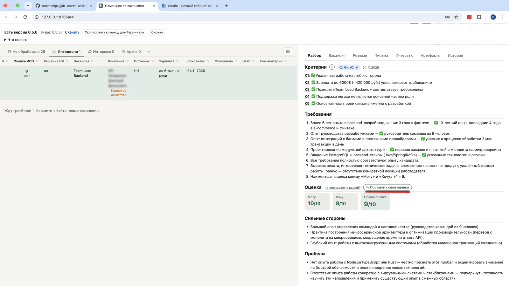
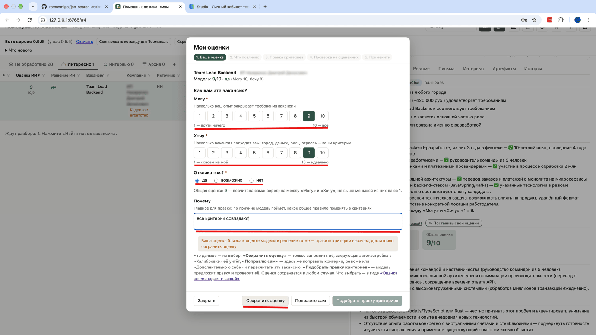
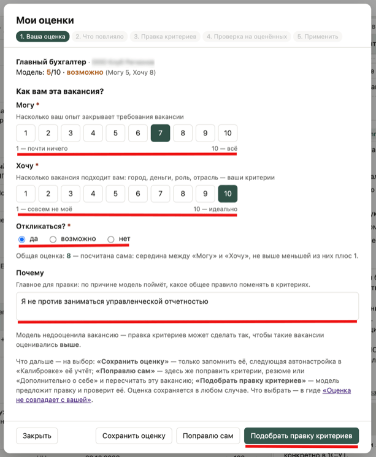
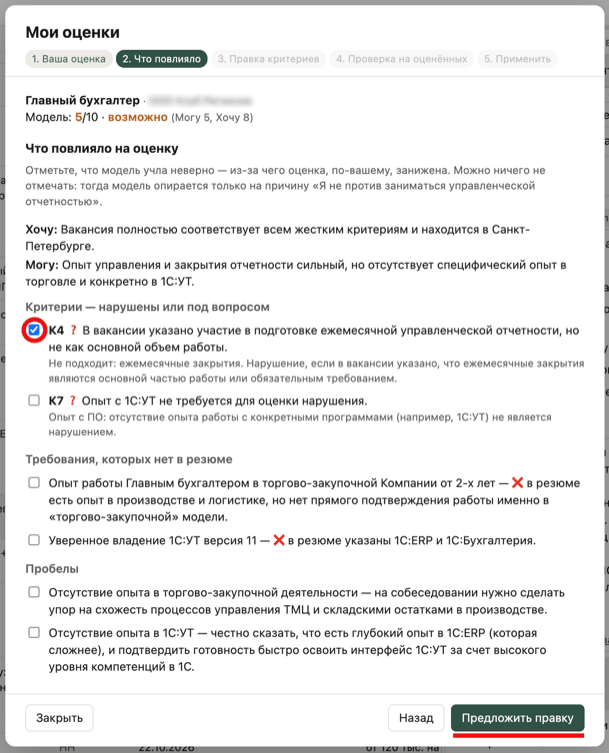
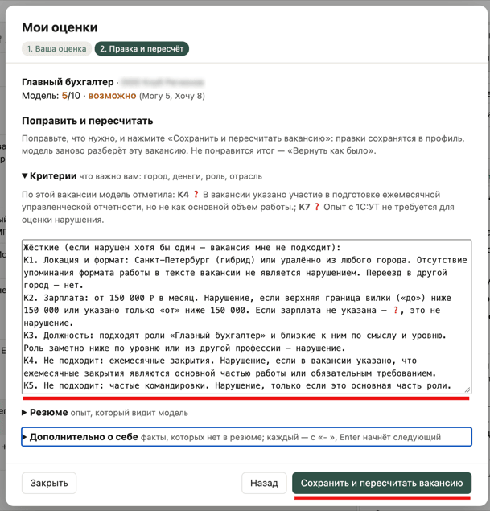
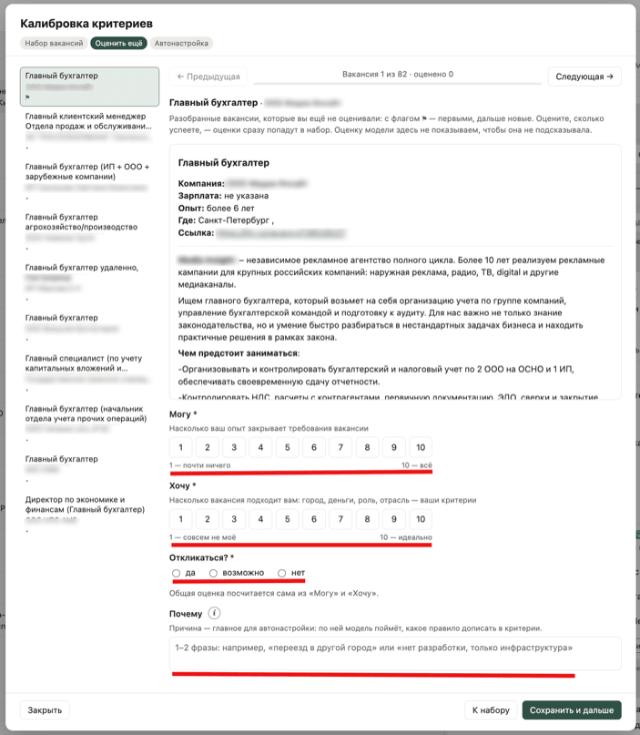
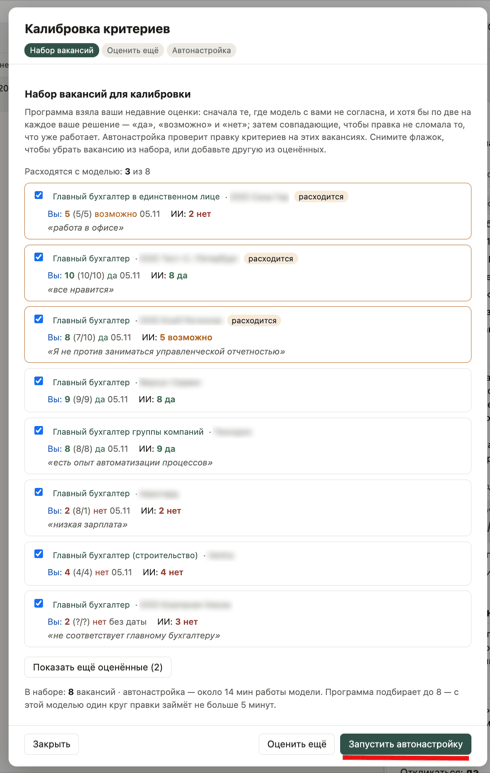

# Настройка критериев под человека

Модель оценивает вакансии ровно настолько хорошо, насколько ясно записаны критерии. Сразу после создания профиля она смотрит на вакансии «чужими глазами»: не знает, что для человека важно, и оценивает в основном «может ли он», а не «хочет ли». Этот документ о том, как довести оценки модели до совпадения с вашими.

**Основной способ — калибровка в окне программы** («Параметры → Калибровка критериев»). Вы оцениваете вакансии сами, а подбирать формулировки критериев помогает модель — та же, что оценивает вакансии: локальная Gemma (всё остаётся на вашем компьютере) или облачный GigaChat, если он выбран в «Параметры → Настройки → Модель профиля». Ручная настройка описана в конце. Она для тех, кто хочет понять, что происходит внутри, или поправить критерии точечно.

## Как модель оценивает вакансию

С **локальной моделью** способ выбирается в «Параметры → Настройки → Как оценивать вакансии — для локальной модели». Вариантов два:

- **В две ступени** — быстрее, выбран по умолчанию. Сначала каждая новая вакансия получает быструю оценку, около 15 секунд: отметки по жёстким критериям, «Могу» и «Хочу», общая оценка и решение «откликаться: да / возможно / нет». Затем только для «да» и «возможно» делается полный разбор, около минуты: требования вакансии, сильные стороны и пробелы — на нём строится сопроводительное письмо. Для любой другой вакансии полный разбор можно запустить кнопкой в её карточке.
- **В одну ступень** — точнее, но дольше. Каждая вакансия сразу получает полный разбор: модель сначала объясняет каждый критерий и только потом ставит оценку. Около минуты на вакансию. Быстрая оценка ставит отметки без рассуждений и на пограничных вакансиях ошибается чаще — например, может принять «производственную компанию» за роль про автоматизацию производства.

С **облачной моделью GigaChat** каждая вакансия всегда получает полный разбор: он занимает секунды, экономить на быстрой оценке незачем.

Критерии профиля используют оба способа. Калибровка проверяет их тем способом, каким программа сейчас оценивает вакансии: быстрой оценкой — в две ступени, полным разбором — в одну ступень и с GigaChat. Поэтому после смены модели или способа оценки калибровку стоит повторить: критерии, подобранные под одну модель, у другой могут давать другие решения. В карточке вакансии значок «Gemma» или «GigaChat» в заголовке «Критерии» показывает, какая модель её разбирала.

## Калибровка в окне: по шагам

### 0. Ставьте свои оценки по ходу работы

Калибровка берёт **ваши собственные оценки** вакансий. Ставить их удобнее всего сразу, когда читаете вакансию: в карточке, у блока «Оценка», — кнопка «✎ Поставить свои оценки». Там вы указываете «Могу», «Хочу», решение (да / возможно / нет) и причину. Оценку с датой программа запоминает.



| Поле | Что указать |
|---|---|
| Могу | насколько ваш опыт закрывает требования вакансии: 1 — почти ничего, 10 — всё |
| Хочу | насколько вакансия подходит вам — город, деньги, роль, отрасль: 1 — совсем не моё, 10 — идеально |
| Откликаться? | да / возможно / нет |
| Почему | 1–2 фразы: настоящая причина («переезд в другой город», «только инфраструктура, без разработки», «зарплата ниже моей планки») |

Общую оценку программа считает сама: середина между «Могу» и «Хочу», не выше меньшей из них плюс 1, при «нет» — не выше 4 — так же, как модель.

**«Почему» — самое ценное поле.** Из него модель берёт материал для правок; без причины ей не на что опереться. Пример, что писать, — в самом поле, пока оно пустое; в калибровке на шаге «Оценить ещё» рядом с полем есть подсказка «i».



Если ваша оценка близка к оценке модели и решение то же, как на снимке, править критерии незачем — достаточно «Сохранить оценку».

**Если оценка расходится с моделью**, внизу окна — три пути. Ваша оценка сохраняется в любом случае:

- **«Сохранить оценку»** — только запомнить её; следующая калибровка её учтёт.
- **«Подобрать правку критериев»** — правку по этой вакансии подберёт модель.
- **«Поправлю сам»** — поправить критерии, резюме или «Дополнительно о себе» своими руками.



**«Подобрать правку критериев».** На шаге «Что повлияло» отметьте, что модель учла неверно: критерий, требование, которого нет в резюме, или пробел. Можно ничего не отмечать — тогда модель опирается только на вашу причину из «Почему». Нажмите «Предложить правку»: модель предложит минимальную правку критериев и сразу проверит её на этой вакансии, а затем на уже оценённых — не сломала ли правка остальное. Рабочие критерии меняются только по кнопке «Применить» на последнем шаге. Если отметили требование или пробел, окно предупредит: это пробел в резюме, а не в критериях, — такой опыт лучше дописать в «Дополнительно о себе».



**«Поправлю сам».** В окне открываются критерии, резюме и «Дополнительно о себе» — поправьте, что нужно, и нажмите «Сохранить и пересчитать вакансию»: правки сохранятся в профиль, модель заново разберёт эту вакансию. Не понравится итог — «Вернуть как было».



Особенно полезны оценки там, где вы **не согласны с моделью**: именно на них калибровка учится. Нужны и **разные решения** — и «да», и «нет»: на одних «нет» модели не на чем учиться отличать одно от другого. Оценки сохраняются в `профили/<имя>/мои-оценки.md`.

Когда разобранных вакансий наберётся 10, программа сама предложит калибровку.

### 1. Набор вакансий

«Параметры → Калибровка критериев» → шаг **«Набор вакансий»**. Набор программа подбирает сама из ваших оценок:

- **свежие** — по дате вашей оценки: старые оценки могли устареть;
- **хотя бы по две на каждое ваше решение** — «да», «возможно» и «нет», если такие есть;
- **сначала — где модель с вами не согласна**: другое решение или оценка отличается на 2 и больше. Такие вакансии помечены «расходится»;
- **затем — совпадающие**, чтобы правка не сломала то, что уже работает.

Число вакансий зависит от модели: с GigaChat — до 12, с локальной моделью при двух ступенях — до 8, при полном разборе — до 6. Так один круг автонастройки (прогон текущих критериев и новой версии) занимает не больше 5 минут.

У каждой вакансии видны ваша оценка («могу/хочу»), решение и дата, оценка и решение модели, ваша причина. Если навести мышь на карточку, рядом покажется текст вакансии; по названию открывается её карточка.

- **Убрать вакансию** из набора — снимите флажок.
- **Добавить другую** — «Показать ещё оценённые», там же поиск по названию и компании; поставьте флажок.
- **«Подобрать заново»** — забыть, какие вакансии вы убрали и добавили.

Внизу — сколько вакансий в наборе и примерное время автонастройки. Набор с вашими правками запоминается; новые оценки сами попадают в него при следующем открытии.

**Мало оценок?** Нужно хотя бы 6 вакансий в наборе. Если их меньше или модель везде согласна с вами, окно подскажет оценить ещё: в карточках вакансий или кнопкой **«Оценить ещё»**.

### 2. Оценить ещё (необязательно)

Шаг для тех, у кого своих оценок мало. Здесь — разобранные вакансии, которые вы ещё не оценивали: с флагом ⚑ — первыми, дальше новые. Слева — список: «✓ 7 · да» — уже оценили, «⚑» — с флагом, «•» — ещё нет; на узком экране он становится выпадающим. Оценку модели здесь не показываем, чтобы она не подсказывала. Поля — те же, что в карточке; если у вакансии есть комментарий, он подставится в «Почему». Оцените, сколько успеете, — оценки сразу попадут в набор. «К набору» — вернуться.

Для каждой вакансии:

- **«Могу»** — насколько ваш опыт закрывает требования: 1 — почти ничего, 10 — всё;
- **«Хочу»** — насколько вакансия подходит вам: город, деньги, роль, отрасль;
- **«Откликаться?»** — да, возможно или нет; общая оценка посчитается сама из «Могу» и «Хочу»;
- **«Почему»** — одна-две фразы о причине, например «переезд в другой город». Это главное для автонастройки; что писать, подскажет значок «i» рядом с полем.

Нажмите **«Сохранить и дальше»** — откроется следующая вакансия. «Следующая» — пропустить вакансию без оценки.



### 3. Автонастройка

Кнопка **«Запустить автонастройку»** — 3 раунда правок только на вакансиях набора. Ход задачи виден на панели «Задачи» (песочные часы в шапке): щелчок по задаче показывает журнал, там же кнопка «Остановить».



После прогона откроется шаг **«Автонастройка»** с итогом:

- таблица версий с показателями;
- **было → стало по каждой вакансии**: ваша оценка, оценка модели с текущими критериями и с лучшей версией — «исправилось», «сломалось», «совпадает» или «расходится»;
- разница «что изменится в критериях».

**Рабочие критерии сами не меняются.** Прочитайте разницу: формулировки должны быть вашими. Если устраивают, нажмите **«Применить лучшую версию»**. Прежние критерии останутся в истории версий. Программа предложит переоценить вакансии по новым критериям: выберите разделы («не обработано», «интересно», «интервью», «архив»), комментарии, статусы и флаги сохранятся.

### 4. Проверьте на новых вакансиях

На небольшом наборе модель может «выучить» конкретные случаи. После применения посмотрите на 3–5 **новых** вакансий: совпадает ли решение модели с вашим. Дальше — по ходу работы: где не согласны, ставьте свою оценку в карточке, и когда расхождений накопится несколько, запустите калибровку снова — набор соберётся из них.

Статусы «интересно / интервью / архив» и комментарии — тоже материал: если вы часто отправляете в «архив» вакансии с высокой оценкой, поставьте им свою оценку с причиной — она попадёт в следующую калибровку.

## История версий критериев

Каждая версия критериев запоминается: из мастера, из опросника, ручные правки и кандидаты автонастройки — с их показателями. Посмотреть и вернуть любую: «Параметры → Критерии модели» → **«Выбрать из прежних версий»**.

- У проверенных версий видны показатели последней калибровки; выбирайте по ним.
- Ручные правки, которые ещё не проверялись калибровкой, отмечены красным: «ручная правка — на калибровке не проверялась». Их качество неизвестно; такие версии можно удалить прямо в списке.
- Так же хранятся версии шаблонов письма: «Параметры → Шаблоны писем» → «Прежние версии этого шаблона».

## Как работает автонастройка



1. **Эталон** — вакансии набора, у которых есть ваше решение «да / возможно / нет» (нужно хотя бы 6).
2. **Версия 0:** программа прогоняет текущие критерии на эталонных вакансиях (тем же способом, каким оцениваются вакансии) и считает показатели.
3. **Раунд:** показывает модели вакансии, где она ошиблась, — с вашими причинами и её проверкой критериев — и просит переписать критерии. Сначала исправляются пропущенные подходящие, потом лишние «да».
4. **Проверка кандидата:** нумерация К1, К2…, не больше 8 жёстких критериев, нет названий компаний из эталона — защита от подгонки под конкретные вакансии.
5. **Прогон кандидата** на тех же вакансиях. Кандидат становится лучшей версией, **только если показатели лучше** — в порядке: меньше пропущенных подходящих → больше совпавших решений → больше оценок в пределах ±2 → меньше среднее расхождение. Неудачные правки запоминаются, чтобы модель их не повторяла.
6. Все прогоны идут с одинаковым «зерном» случайности (seed): сравниваются версии критериев, а не разброс между запусками. У GigaChat «зерна» нет — с ним результаты калибровки немного плавают от запуска к запуску.
7. После 3 раундов (или когда все решения совпали) — итог, лучшая версия и все кандидаты попадают в историю версий.

Подробности прогона лежат в `профили/<имя>/настройка/`: `отчёт.md` (версии, показатели, разница), `критерии — лучшие.txt`, `критерии vN.txt` и ответы модели по каждой версии.

### Как понять, что настройка удалась

| Показатель | Хорошо |
|---|---|
| Решение «откликаться» совпало | в 9–10 из 12 |
| Оценка отличается от вашей не больше чем на 2 балла | в 8 из 10 |
| **Пропущено подходящих** (вы — «да», модель — «нет») | **0** — самая дорогая ошибка: такую вакансию вы не увидите |
| Лишние «да» (вы — «нет», модель — «да») | 1–2 допустимо: отсеете сами за минуту |

> Даже на одних и тех же критериях оценки модели между обычными прогонами плавают на ±1–2 балла. Не делайте выводов по одной вакансии — смотрите на набор.

### Если улучшить не удалось

- **Причины не записаны.** Чаще всего в поле «Почему» нет настоящей причины отказа или она слишком общая («не интересно»). Допишите конкретно — что именно в вакансии не подходит — и запустите снова.
- **Мало разных решений.** Если почти все вакансии «нет», добавьте подходящие (и наоборот).
- **Не каждое предложение модели удачное.** Часть кандидатов отбрасывается проверкой или не улучшает показатели — это нормально, программа их просто не принимает.
- **Потолок модели.** Если две-три калибровки подряд ничего не меняют, оставшиеся ошибки проще отсеивать глазами. Нормальный итог — когда остались только «лишние да», а пропущенных подходящих нет.

### То же из командной строки

Для тех, кто запускает программу из терминала, есть те же шаги командами:
```bash
python3 razbor.py --profile ivan ratings            # заготовка таблицы мои-оценки.md (без оценок модели)
python3 razbor.py --profile ivan tune               # автонастройка, 3 раунда; число можно указать: tune 5
python3 razbor.py --profile ivan tune apply         # применить лучшую версию
python3 razbor.py --profile ivan --all              # переоценить все вакансии по новым критериям
```

---

## Дополнение: ручная настройка

Для тех, кто хочет понять, что делает автонастройка, или поправить критерии точечно — без прогона всего цикла.

### Что настраивается и где

| Что | Где править | Когда |
|---|---|---|
| Жёсткие критерии К1, К2… — нарушен хотя бы один → «нет» | «Параметры → Критерии модели» (файл `критерии.txt`) | почти всегда — здесь основная работа (автонастройка правит только их) |
| Мягкие критерии (+ и −) — влияют на «Хочу», но не отсекают | там же | когда оценка «не та», а решение верное |
| Отбор по названию — до модели, без затрат времени | «Параметры → Редактировать профиль» → шаг «Отбор по названию» | когда в разбор попадают вакансии явно не той профессии или уровня |
| Вступление: важные оговорки о себе | `профиль.json` → `разбор` → `вступление` | когда модель делает неверный вывод о человеке |
| Правила оценки, формат ответа | `шаблоны/скоринг v1.txt` и `шаблоны/разбор v7.txt` | редко: общие для всех профилей, менять осторожно |

Ручная правка критериев в окне сохраняется отдельной версией в истории — к прежней всегда можно вернуться.

Посмотреть промпт целиком — так, как его получает модель:
```bash
python3 razbor.py --profile ivan prompt        # с заглушкой вместо вакансии
python3 razbor.py --profile ivan prompt 7      # с вакансией номер 7
```

### Разбор ошибок

Для каждой вакансии, где решение не совпало (в наборе калибровки они помечены «расходится»), откройте её карточку и найдите, **на каком шаге** модель ошиблась:

- в блоке **«Критерии»** — неверно отмечен ✅ / ❌ (значок ⓘ рядом с заголовком показывает полный текст критериев);
- в блоке **«Требования»** (полный разбор) — опыт засчитан там, где его нет, или наоборот;
- в **«Могу» / «Хочу»** — всё отмечено верно, а оценка не та.

Типовые причины и что с ними делать:

| Что видно | Причина | Что поправить |
|---|---|---|
| Модель говорит «да» почти всему | Ваши причины отказа не записаны: модель оценивает только «может ли» | Перенести причины из «Почему» в жёсткие критерии |
| Отказ из-за одного слова в вакансии (например, «1С» среди других систем) | Критерий слишком широкий | «Нарушение, **только если** это основная часть роли» |
| Странный вывод о вас («нужна только временная работа») | Модель додумала по резюме | Явная оговорка во `вступлении` |
| Порог зарплаты срабатывает неверно | Не уточнены «на руки / до вычета», «постоянная / проектная», «вилка не указана» | Расписать критерий по случаям |
| Курсы засчитаны как практический опыт | Модель натягивает подтверждения | Правило в шаблоне (общее для всех) — уже есть в `разбор v7` |
| «Нет опыта управления командой 50+», хотя в резюме 150 человек | Модель не сравнивает числа | Правило в шаблоне — есть в `разбор v7`; можно и строкой в «Дополнительно о себе» |
| После правки стало хуже в другом месте | Противоречие внутри промпта | Посмотреть промпт целиком (команда выше) и найти правило, которое мешает новому |
| Выглядит верно, но решение то одно, то другое | Разброс между прогонами | Не править; смотреть на набор |

Автонастройка правит только критерии. Ошибки, которые лечатся вступлением или шаблоном, правятся только вручную.

### Одна правка — одна проверка

1. Внесите **одну** правку (или несколько, но про одну причину) и сохраните — версия попадёт в историю.
2. Переоцените вакансии из набора калибровки и сравните оценки модели со своими.
3. Не стало лучше — верните прежнюю версию через «Выбрать из прежних версий».

Если поменять всё сразу, не поймёте, что помогло, а что сломало. После каждой правки перечитывайте критерии целиком, а не только изменённое место: противоречия ломают результат незаметно. Обычно хватает 3–5 итераций.
