# Первый запуск: установка и настройка

Пошагово — от установки на Mac или Windows до первых разобранных вакансий. Пример — профиль Java-тимлида с облачной моделью GigaChat. Красным на снимках отмечено то, что нужно нажать или заполнить.

Займёт минут 15: 2 — установка, 5 — ключ GigaChat, остальное — ответы мастера.

## Установка

### 1. Откройте страницу загрузки

Страница загрузки — [github.com/romanmigal/job-search-assistant-releases](https://github.com/romanmigal/job-search-assistant-releases).

- **Mac:** в разделе «Установка на Mac» нажмите значок копирования справа от команды.
- **Windows:** скачайте установщик `VacancyAssistant-windows-setup.exe` из таблицы «Скачать последнюю версию».

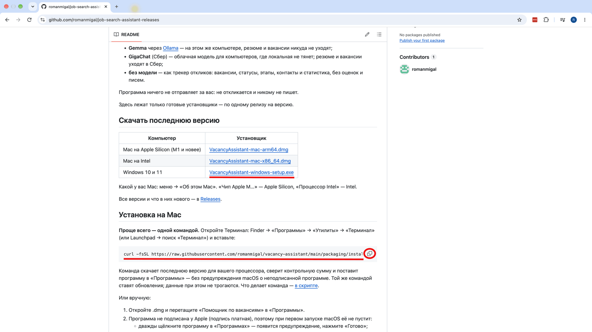

### 2. Установите программу

#### На Mac

Откройте Терминал: Finder → «Программы» → «Утилиты» → «Терминал». Вставьте команду (⌘V) и нажмите Return.

Команда скачает последнюю версию для вашего Mac, сверит контрольную сумму и поставит программу в «Программы». Когда появится «Готово», программа откроется в браузере сама. Предупреждения macOS о неподписанной программе не будет.

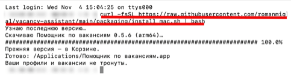

#### На Windows

Запустите скачанный `VacancyAssistant-windows-setup.exe`. Программа не подписана (подпись платная), поэтому Windows покажет синее окно «Система Windows защитила ваш компьютер». Нажмите «Подробнее»:

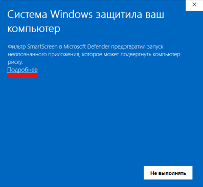

Появится кнопка «Выполнить в любом случае» — нажмите её:

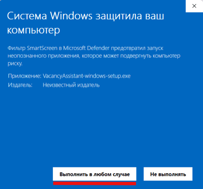

Дальше — обычный установщик: «Далее» (папку установки можно оставить как есть) → «Далее» (ярлык на рабочем столе — по желанию) → «Установить» → «Завершить». Права администратора не нужны. С отмеченной галочкой «Запустить Помощник по вакансиям» программа откроется в браузере сама; потом её запускают из меню «Пуск» или ярлыком на рабочем столе.

## Модель и ключ GigaChat

### 3. Выберите модель

Мастер нового профиля начинается с выбора модели: можно выбрать облачную или локальную. Рекомендуем оставить **«Облачная — GigaChat (Сбер)»**: она в несколько раз быстрее и не нагружает компьютер. Резюме и вакансии при этом уходят в Сбер, а имя, телефон и почта заменяются метками.

Для GigaChat нужен ключ. Ниже, в блоке «Ключ авторизации», нажмите ссылку **developers.sber.ru** — она откроется в новой вкладке.

Если не хотите отправлять данные в облако — выберите «Локальная»: она работает на вашем компьютере, и резюме с вакансиями никуда не уходят. Для неё нужны программа Ollama, около 8 ГБ на диске и 16 ГБ памяти; ключ GigaChat не нужен, шаги 4–10 о нём пропустите. Есть и вариант «Без модели» — только трекер откликов.

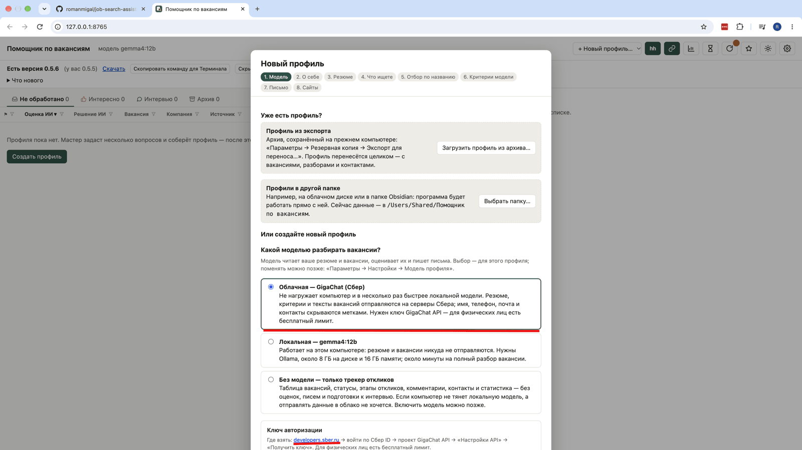

### 4. Войдите на developers.sber.ru

Войдите удобным способом — проще всего через Sber ID или по номеру телефона. Регистрация бесплатная.

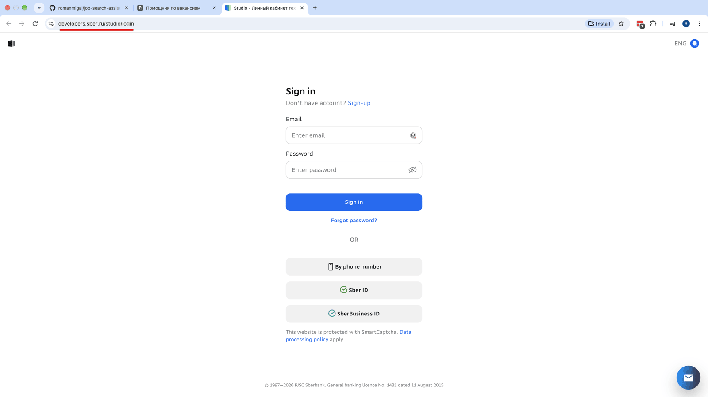

### 5. Создайте проект GigaChat API

На главной странице в карточке **GigaChat API** нажмите «Create project».

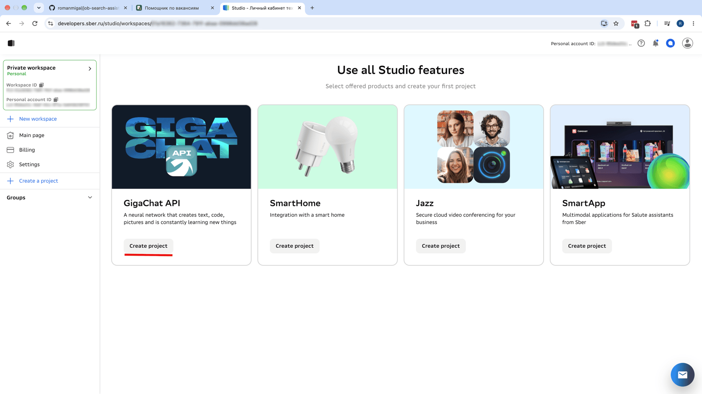

### 6. Подтвердите создание проекта

Название можно оставить как есть. Нажмите «Create project».

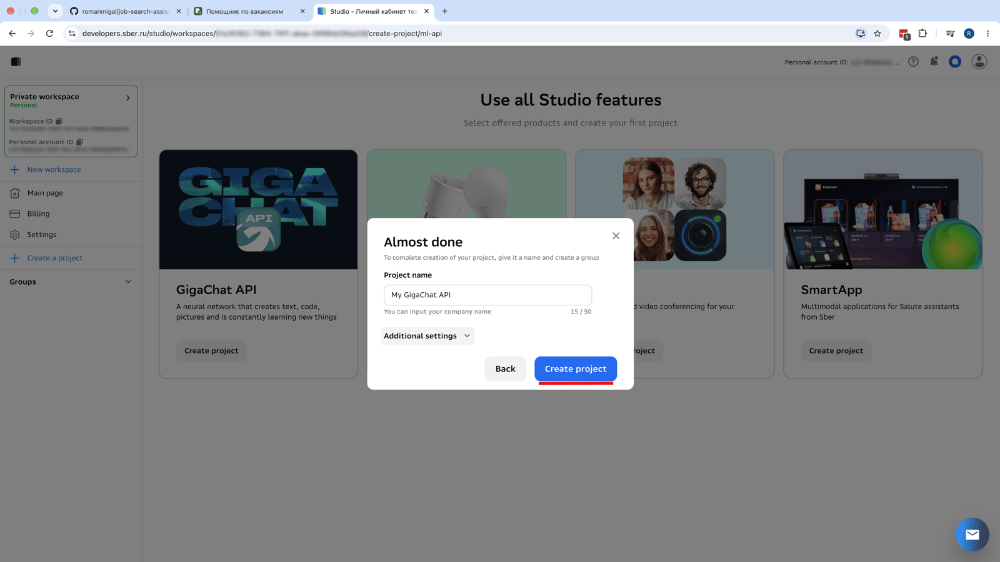

### 7. Откройте настройки API

На странице проекта нажмите «Setup API».

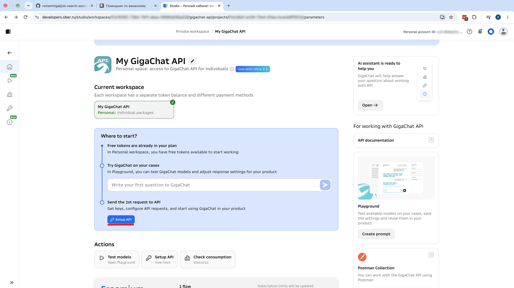

### 8. Получите ключ

В блоке «Authorization key» нажмите «Get key».

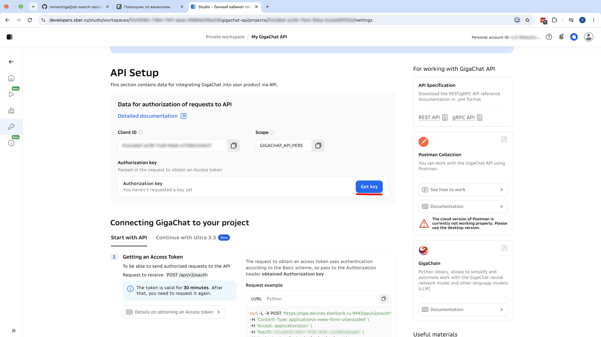

### 9. Скопируйте ключ

Нажмите значок копирования справа от ключа.

**Ключ показывается один раз.** Не закрывайте окно, пока не вставите его в программу. Если всё же потеряли — вернитесь к шагу 8 и получите новый: старый перестанет работать.

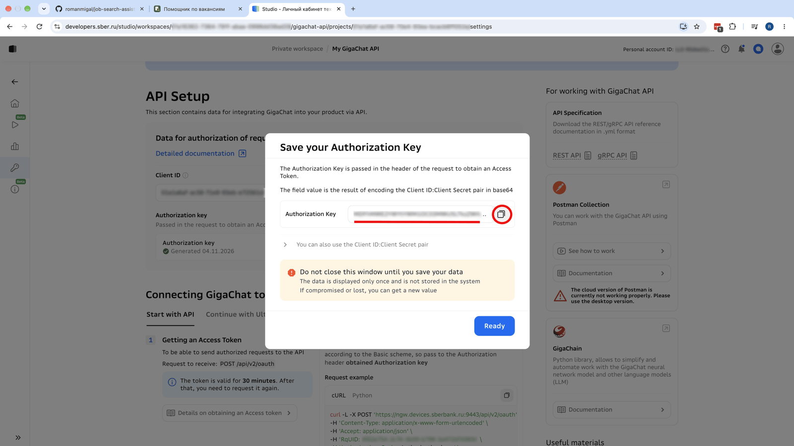

### 10. Вставьте ключ в программу

Вернитесь во вкладку программы и вставьте ключ в поле «Ключ авторизации».

- «Тип доступа» — «физическое лицо», «Модель» — GigaChat-2-Pro: так и оставьте.
- Нажмите «Проверить подключение» — должно появиться «Работает».
- Отметьте согласие с тем, что резюме и вакансии отправляются в Сбер.
- Нажмите «Подключить и дальше».

Ключ хранится только на вашем компьютере.

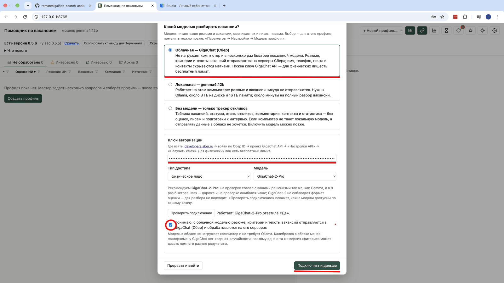

## Профиль

### 11. О себе

Имя и фамилия нужны для подписи писем; имя профиля подставится само. Выберите, как писать в письмах — «рад» или «рада». В поле «Ваша сфера» — пара слов о том, чем занимаетесь, например «Java-разработка e-commerce финтех». И когда можете выйти на работу.

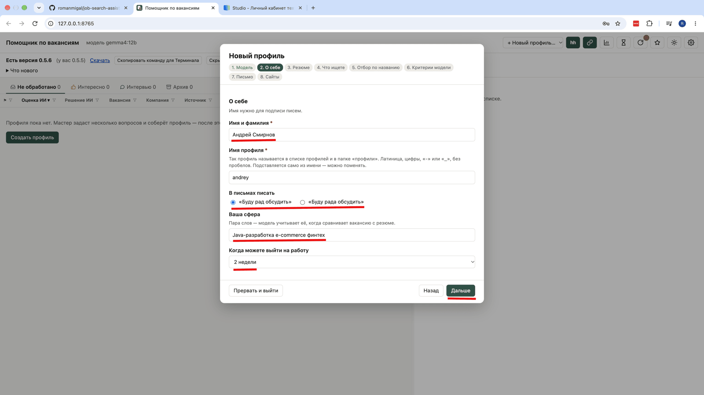

### 12. Резюме

Загрузите резюме файлом — на hh.ru: резюме → «Скачать» → TXT — или вставьте текст в поле. Проверьте текст: модель знает о вас только то, что в нём написано.

Если выбрали GigaChat, под резюме будет галочка «Скрывать от GigaChat и прошлых работодателей» со списком компаний из резюме. Имя, телефон, почта и контакты скрываются всегда; работодателей — по желанию. Без них модель хуже понимает ваш опыт: не знает отрасль и размер компаний. Поэтому по умолчанию галочка выключена.

В поле «Дополнительно о себе» допишите то, чего нет в резюме, но что важно для оценки: пет-проекты, языки, отраслевые знания. Каждый факт — с новой строки.

Модель учитывает эти факты наравне с резюме: так оценка вакансий точнее, а аналитика и рекомендации — что дописать в резюме, каких навыков не хватает — полнее. Пишите только правду.

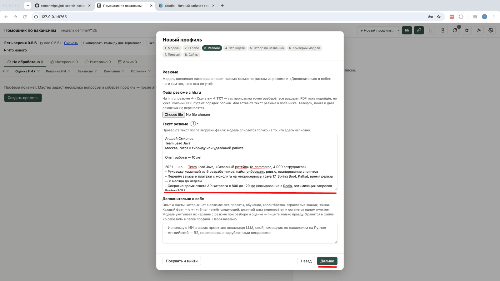

### 13. Что ищете

- **Должности** — по одной на строку: по ним программа ищет вакансии.
- **Город**, **зарплата от** и **формат работы** — офис, гибрид, удалённо.
- **Занятость** — отметьте, если подходят и проектные роли с частичной занятостью.
- **Что важно** — плюсы: не отсекают вакансию, но повышают оценку.
- **Что точно не подходит** — если это основная часть роли, вакансия получит «нет».

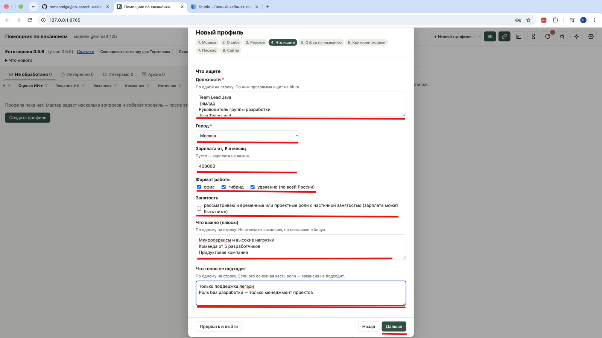

### 14. Отбор при поиске

Здесь программа отсеивает явно неподходящие вакансии ещё до модели — по словам в названии и по зарплате. Мастер заполнил списки по вашим должностям; проверьте их:

- **Профессия** — в названии должно быть хотя бы одно из этих слов;
- **Уровень** — и хотя бы одно из этих;
- **Стоп-слова** — с ними вакансия отсеивается сразу: «стажёр», «junior», «младший».

Слово можно писать не целиком: «разраб» подойдёт и для «разработчик», и для «разработки».

- **Зарплата при поиске на hh.ru** — фильтр самого hh.ru: вакансии с меньшей зарплатой не попадут в поиск. Мастер подставил сумму из шага «Что ищете». Без галочки «только с указанной зарплатой» hh оставляет и вакансии, где зарплата не указана. Пусто — без фильтра.

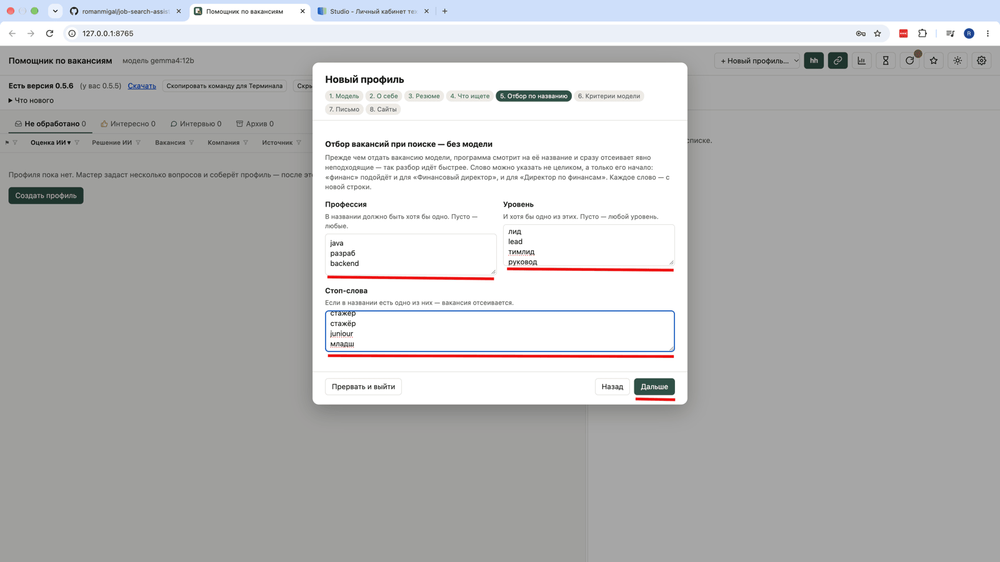

### 15. Критерии модели

Мастер собрал критерии из ваших ответов: город и формат, зарплата, должность, что не подходит. По ним модель решает, подходит ли вакансия. Прочитайте и поправьте, если что-то записано не так. Точнее настроить их можно позже, калибровкой (шаг 23).

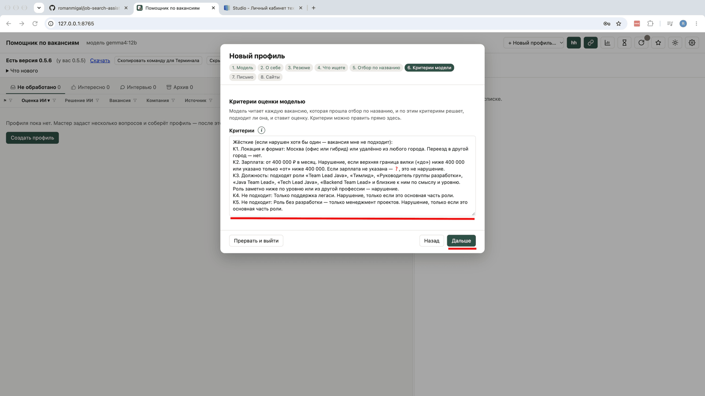

### 16. Образец письма

По образцу модель пишет сопроводительные письма: берёт из него стиль и длину, а факты — только из резюме. Вставьте своё удачное письмо или поправьте заготовку — замените текст в [скобках].

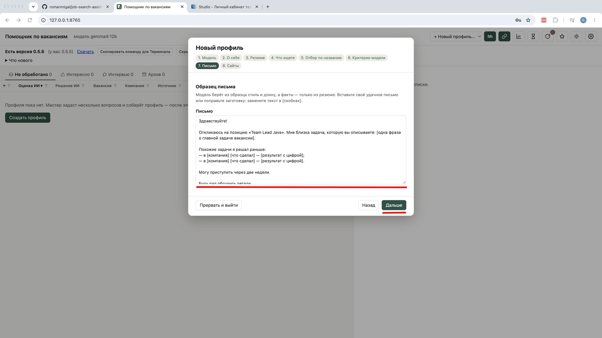

### 17. Сайты

Откуда брать вакансии:

- **Поиск на hh.ru программой** — по желанию и на ваш риск: соглашение hh.ru запрещает такие программы, и hh может заблокировать аккаунт. Чтобы включить, отметьте обе галочки. Без него вакансии с hh.ru добавляются вручную: сохраните страницу вакансии в браузере (⌘S) и перетащите файл в окно программы.
- **Ленты Хабр Карьеры и GeekJob** — для вакансий в ИТ, это официальный способ подписки.
- **Разрешаю разбирать страницы вакансий моделью** — модель вырежет со страницы любого сайта саму вакансию, без меню и рекламы.

Нажмите «Создать профиль».

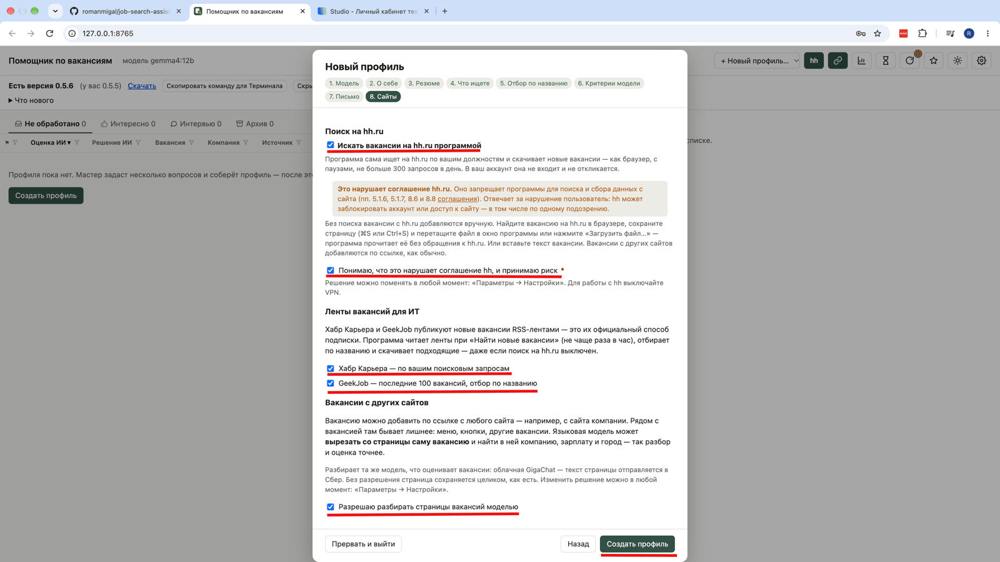

## Первые вакансии

### 18. Профиль создан

Нажмите «Найти новые вакансии».

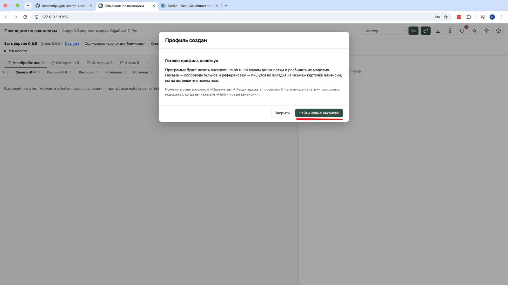

### 19. Предупреждение про hh.ru

Если включили поиск на hh.ru, программа ещё раз напомнит о риске. Для поиска выключите VPN и нажмите «Искать на hh.ru».

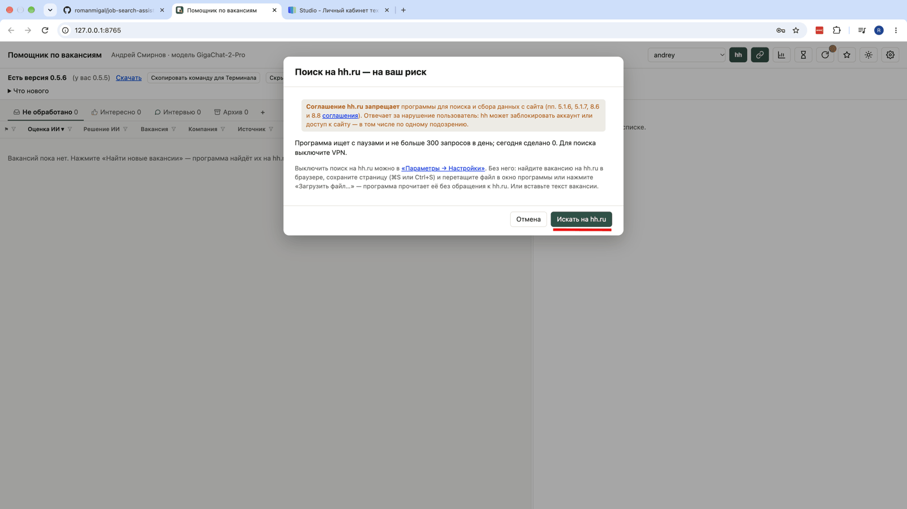

### 20. Первый поиск

Для начала нажмите «Загрузить 15 вакансий»: с GigaChat разбор займёт пару минут, и этого хватит, чтобы проверить критерии. Остальные найденные вакансии подтянутся при следующих поисках.

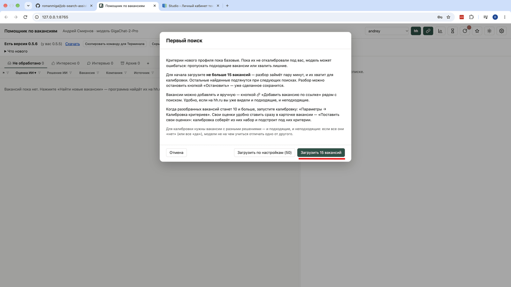

### 21. Ход поиска

Окно «Задачи» показывает, что программа делает сейчас. Его можно скрыть — работа продолжится. Открыть снова — кнопкой с песочными часами в верхней панели (на снимке отмечена).

- **Песочные часы крутятся** — программа работает: ищет, скачивает или разбирает вакансии. Пока идут задачи профиля, кнопки поиска и пересчёта оценок недоступны. Остановились — всё готово, щелчок по часам покажет задачи, законченные за последний час.
- **Щёлкните по задаче в окне**, чтобы раскрыть подробный журнал: какие запросы обработаны, сколько вакансий найдено и отсеяно, что разобрано. Там же кнопка «Остановить» — уже сделанное сохранится.

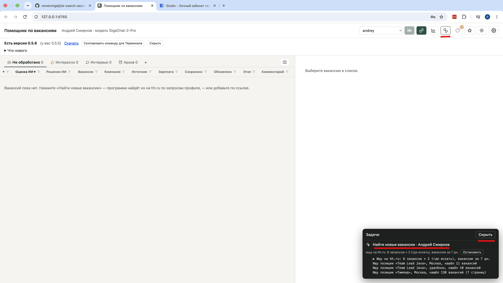

### 22. Разобранные вакансии

Вакансии появляются в списке по мере разбора: оценка модели, решение «да / возможно / нет», компания, зарплата. Нажмите на вакансию — справа откроется карточка: разбор по критериям и требованиям, письма, подготовка к интервью.

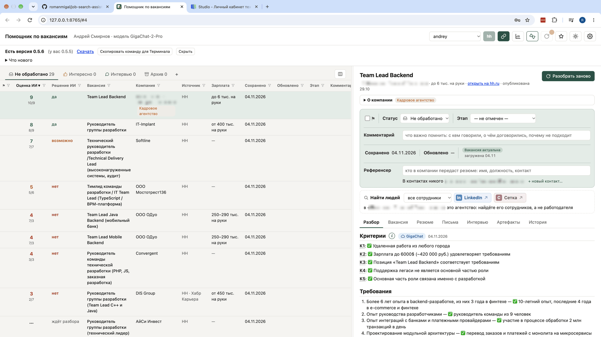

### 23. Калибровка — позже

Когда разобранных вакансий станет достаточно, программа предложит откалибровать критерии: вы оцениваете несколько вакансий сами, и модель подстраивает критерии под ваши оценки. Можно сразу, а можно нажать «Позже» и вернуться к этому в «Параметры → Калибровка критериев». Подробно — в [«Настройка критериев»](Настройка%20критериев.md).

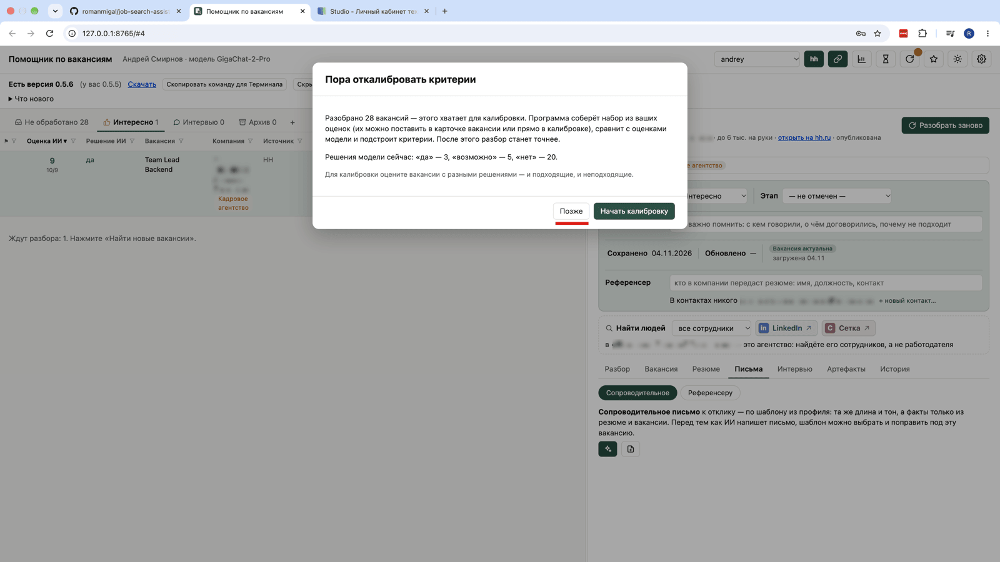
